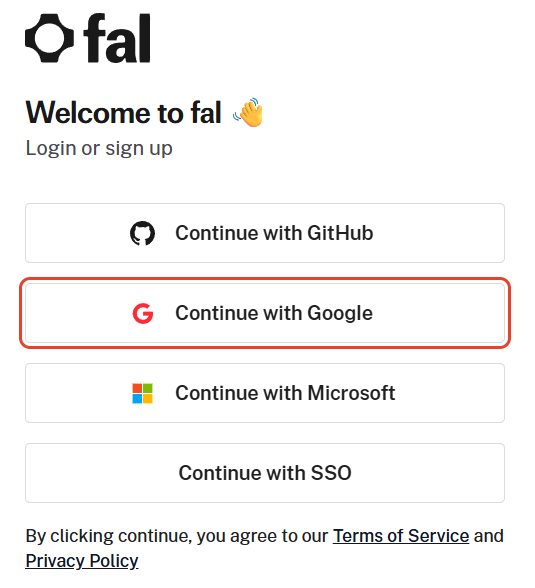
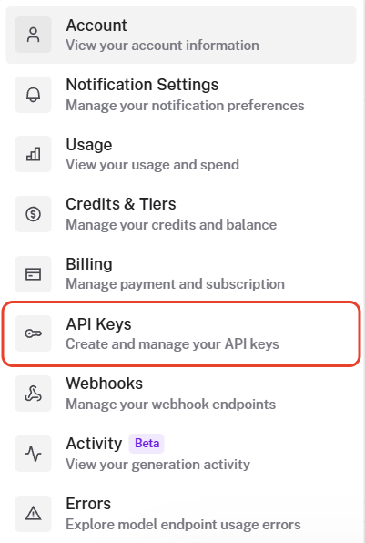
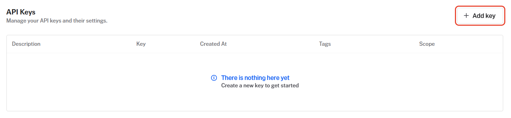
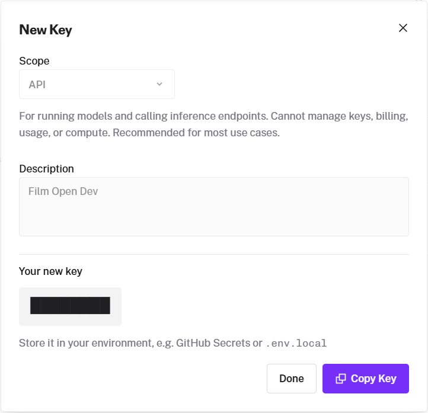

- [What it is and what FilmOpen uses it for](#what-it-is-and-what-filmopen-uses-it-for)
- [Pricing](#pricing)
- [FilmOpen credit](#filmopen-credit)
- [Create your own key](#create-your-own-key)
- [The plugin](#the-plugin)
- [If something goes wrong](#if-something-goes-wrong)

Implemented in plugin [`fo-fal`](#the-plugin).

## What it is and what FilmOpen uses it for

fal runs many makers' image, video and voice models behind one account and one key. FilmOpen uses it for pictures, video clips and voices.

| Model | Made by | What it does in FilmOpen |
|---|---|---|
| GPT Image 2.5 | OpenAI | Makes an image from a prompt, or edits one with reference images |
| Z-Image-Turbo | Alibaba (Tongyi Lab) | Makes an image from a prompt, quickly and cheaply |
| FLUX.2 [klein] 4B | Black Forest Labs | Edits an image |
| MiniMax H3 Max and Seedance 2.5 | MiniMax and ByteDance | Make a shot from a prompt, or from its first frame |
| Kling Avatar 2.0 and LTX-2.5 | Kuaishou and Lightricks | Make a speaking shot, or one timed to your own audio |
| Eleven v3 | ElevenLabs | Speaks a line |
| MiniMax and Qwen voices | MiniMax and Alibaba (Qwen) | Design a voice and speak with it |
| Voice description | fal | Describes a recording's voice so you can write a prompt from it |

The catalogue names which models each plugin offers, and the render dialog shows the ones you can use. The [technical notes](/docs/platforms/fal-notes/) cover fal's API in more depth.

## Pricing

fal is prepaid: you buy credits, and each request's cost comes off them ([pricing](https://fal.ai/docs/documentation/model-apis/pricing)).
- **What is charged.** What fal makes successfully; time waiting in the queue is free (pricing). A failure on fal's side (a 5xx error) is never charged, but a request refused for its input (a 422 error) can be, when fal had already started working on it ([FAQ](https://fal.ai/docs/documentation/model-apis/faq)).
- **Buying credits.** fal's pages don't publish the smallest purchase or a fee. You pay by card or by ACH bank transfer, in US dollars ([terms](https://fal.ai/legal/terms-of-service)).
- **Expiry and refunds.** Credits expire 365 days after you buy them, and free or promotional credits after 90 days. Credits can't be refunded (terms).
- **Tax.** Prices exclude tax, which you pay on top (terms).

Images:

| Model | Price |
|---|---|
| GPT Image 2.5 | Per million tokens: $5 text in, $8 image in, $30 image out |
| Z-Image-Turbo | $0.005 a megapixel |
| FLUX.2 [klein] 4B | $0.01 a megapixel |

Video, per second:

| Model | Price |
|---|---|
| MiniMax H3 Max | $0.05 at 480P, $0.08 at 768P, $0.16 at 1080P |
| Seedance 2.5 | About $0.22 at 480p, $0.47 at 720p, $1.16 at 1080p, fal's estimates |
| Kling Avatar 2.0 | $0.0562 at Standard, $0.115 at Pro |
| LTX-2.5 from your audio | $0.13 per second of input audio at Fast, 1080p; $0.17 at Pro |

Voices:

| Model | Price |
|---|---|
| Eleven v3 | $0.10 per 1,000 characters |
| MiniMax speech | $0.10 per 1,000 characters; a designed voice about $3 |
| Qwen | About $0.09 a line, including the kept sample |

Prices are from FilmOpen's catalogue on 9 November 2026. See [fal's models](https://fal.ai/explore) for today's, and the [technical notes](/docs/platforms/fal-notes/) for more.

## FilmOpen credit

You can use FilmOpen credit instead of your own fal key: FilmOpen can make images and video, speak with Eleven v3 and describe a recording's voice through fal on your balance.

**Top up your FilmOpen account on filmopen.ai.** FilmOpen passes on fal's actual rate and charges 8% plus the payment processor's fees when you top up.

With no fal key of your own saved, the plugin's page says **Ready on FilmOpen credit.** once you are signed in and have a balance; **Sign in to filmopen.ai to use FilmOpen credit.** or **FilmOpen credit: top up on filmopen.ai.** say what is missing. A key of your own wins: once you save one, FilmOpen uses it and fal bills you directly. Voices on fal, the MiniMax and Qwen ones, take your own fal key for now.

## Create your own key

These steps open a fal account of your own and put its key into FilmOpen. The screenshots of fal were taken on its site on 15 September 2026, while an account was opened with Google. Adding credits follows fal's pages, without screenshots.

### Before you start

You need:
- a GitHub, Google or Microsoft account, or your organisation's single sign-on (SSO). fal has no sign-up with an e-mail address and a password ([sign-in page](https://fal.ai/login));
- a card, or ACH, to buy credits ([terms](https://fal.ai/legal/terms-of-service)).

**Choose one way to sign in and keep to it.** Each way of signing in makes a separate fal account, with its own keys and credits, except that a Google and a GitHub account with the same e-mail address share one; single sign-on always makes its own. fal's page doesn't say whether a Microsoft sign-in joins them ([accounts and identity](https://fal.ai/docs/documentation/setting-up/accounts-and-identity)).

**Two-factor sign-in.** fal's pages don't mention it, so turn it on for the GitHub, Google or Microsoft account you sign in with.

**Checks.** fal's pages don't mention a phone or an identity check, and signing in with Google on 15 September 2026 asked for neither.

fal publishes no list of countries. Its terms make you responsible for US export controls and embargoes ([terms](https://fal.ai/legal/terms-of-service)).

### Create an account

1. Open [fal's sign-in page](https://fal.ai/login) and press **Continue with GitHub**, **Continue with Google**, **Continue with Microsoft** or **Continue with SSO**. The same page signs you up the first time, and continuing accepts fal's Terms of Service and Privacy Policy.

   

2. fal opens its dashboard. Its **Getting started** list takes you through adding a payment method, adding credits and making your first image or video.

### Add money

On the dashboard's **Getting started** list, press **Set up billing** to add a payment method, then **Add credits**. **Settings → Billing** and **Settings → Credits & Tiers** lead to the same places.
- **Paying:** by card or ACH, in US dollars ([terms](https://fal.ai/legal/terms-of-service)).
- **Credits expire** 365 days after you buy them, and can't be refunded (terms).
- **What is charged:** see *Pricing*.

### Create a key

1. Open fal's **Settings** menu and choose **API Keys**, or go straight to [fal's keys page](https://fal.ai/dashboard/keys).

   

2. Press **Add key**. On a new account, the list below says there is nothing here yet.

   

3. In **New Key**, choose **API** as the **Scope**. The window describes it as for running models and calling inference endpoints, unable to manage keys, billing, usage or compute. It is all FilmOpen needs, so don't give FilmOpen the **ADMIN** scope, which can also manage apps ([authentication](https://fal.ai/docs/documentation/setting-up/authentication)). Type a **Description** you'll recognise, such as *FilmOpen*, and create the key.
4. **Your new key** appears. Press **Copy Key** and keep the key somewhere safe, such as a password manager, until you add it to FilmOpen: fal shows it only once. Then press **Done**.

   

### Add the key to FilmOpen

FilmOpen keeps your key on this device, encrypted in your operating system's credential store, for your user only. It never puts the key in a project or in its log, never shows it again apart from its last four characters, and sends it only to fal. Plugins run in FilmOpen's desktop app, so add the key there.

1. In FilmOpen, open **Settings**, choose **Plugins**, and press **Configure** on the **fal** row. If it isn't turned on yet, [install and allow it](/docs/guides/plugin-packages/#install-and-allow) first.
2. On the **fal key** card, paste your key into the **API key** box and press **Save**. FilmOpen asks fal about the key before it saves anything, and the card says so while it waits. If what you pasted looks like another platform's key, a line under the box says so and *Save* asks first.
3. A green **Key was accepted** appears under the box, the box empties, and the card says **Verified on** the date, with the key's last four characters. FilmOpen saves no key fal did not accept.

**If the card says something else:**
- **Key is invalid:** fal refused the key, so nothing was saved and the box keeps it. Check that you copied all of it, or create a new key.
- **Could not check:** fal didn't answer in time, couldn't be reached, or answered with an error. Nothing was saved, and the box keeps the key: press **Save** again when the connection is back.
- **Saving this key could not be confirmed:** the box keeps the key. Press **Save** to try again, and if it keeps happening, restart FilmOpen.

**Save** checks the key with fal before it stores anything, without running a model. **Remove** takes the key out of FilmOpen after asking, and the key keeps working on fal until you delete it there.

After pasting a key anywhere, clear your clipboard history if your system keeps one: on Windows, press Win+V and choose **Clear all**.

### Keep the key safe

- **Anyone with your key can spend your credits.** Never put the key in a chat, an e-mail, a shared document or code.
- **fal's pages document no spending limit** for a key or an account, so keep only the credit you mean to spend there.
- **Give FilmOpen a key with the API scope,** never ADMIN.
- **If it may have leaked,** delete it on the API keys page and create a new one; on a team, only its admins can ([teams](https://fal.ai/docs/documentation/setting-up/teams)).
- **Protect the account** you sign in with by turning on its two-factor sign-in.

## The plugin

**fo-fal** puts every fal service FilmOpen offers on one key. Turn the plugin on in **Settings → Plugins**; [Installing plugins](/docs/guides/plugin-packages/) explains installing and allowing one. Its page is opened with **Configure** on its row, and **Check** under **Can it work?** asks the platform about your key without making anything. Check does not prove that every model is open to your key or that you have credit left.

**Rendering.** Open a character, film or shot you can edit, choose **Render**, check the **Model**, **Runs on** and **Way of running it**, and press **Render** once. FilmOpen shows the price before you start. The [model picker](/docs/guides/fo-model-picker/) supplies a default per step, and a [prompt writer](/docs/guides/fo-prompts/) a default prompt.

**Queue and cost.** FilmOpen sends a render once. If the answer is lost, the outcome is uncertain: look at the job and Usage before starting another. When fal reports what a render cost, Usage records it; otherwise it records fal's published price for the units fal counted, or FilmOpen's quote, marked as an estimate. A cost nobody knows stays unknown, never zero. GPT Image, Seedance and Eleven v3 do not apply a seed, so a saved seed does not promise the same result again.

**Voices.** You can design a MiniMax or Qwen voice, keep it, and have it speak. Each generation reads fal's price before sending and is billed from what fal reports. A MiniMax voice is kept in the account behind your fal key; a Qwen voice is the sample kept in your file. FilmOpen makes one attempt: check fal's history before trying again.

**Voice description.** FilmOpen sends a recording you chose, and fills in a description of the voice for you to review. Nothing is written until you accept it.

## If something goes wrong

- **You lost the key:** fal shows it only once. Create a new one, and delete the old one.
- **You signed in and found an empty account:** each way of signing in makes an account of its own, so sign in the way you did the first time ([accounts and identity](https://fal.ai/docs/documentation/setting-up/accounts-and-identity)).
- **Requests are refused when your credits run out:** fal locks an account whose balance falls below its threshold, and refuses its API requests until you add credits ([FAQ](https://fal.ai/docs/documentation/model-apis/faq)).
- **FilmOpen says the key is invalid, or that it could not check it:** nothing was saved and the box keeps the key, so you can put it right and press *Save* again — see [Add the key to FilmOpen](#add-the-key-to-filmopen) for what each line means.
