- [What it is and what FilmOpen uses it for](#what-it-is-and-what-filmopen-uses-it-for)
- [Pricing](#pricing)
- [FilmOpen credit](#filmopen-credit)
- [Create your own key](#create-your-own-key)
- [The plugin](#the-plugin)
- [If something goes wrong](#if-something-goes-wrong)

Implemented in plugin [`fo-google`](#the-plugin).

## What it is and what FilmOpen uses it for

Google makes the Gemini models. With a key from **Google AI Studio**, FilmOpen writes and reads text with Gemini, and makes and edits pictures with Nano Banana.

| Model | What it does in FilmOpen |
|---|---|
| Gemini 3.1 Pro | Writes prose, scenes and scripts, and can use tools |
| Gemini 3.8 Flash | Reads text and returns structured data |
| Gemini 4 Carbon, Gemini 4 Argon | Write prose, scenes and scripts, and can use tools: Carbon the strongest, Argon the faster and lighter |
| Nano Banana Pro and Nano Banana 2 | Make an image from a prompt, or edit one with reference images |

## Pricing

A Google AI Studio key can run on Google's **free tier** or on a **paid** one, once you turn on billing.

- **Free tier:** Gemini 3.8 Flash is free of charge within Google's limits. Your prompts and answers may be used to improve Google's products. Gemini 3.1 Pro, Gemini 4 Carbon, Gemini 4 Argon and the Nano Banana image models are not on the free tier.
- **Paid tier:** press **Set up billing** in AI Studio. New accounts prepay, with $5 the smallest purchase; credits expire after 12 months and can't be refunded. At a balance of zero, requests fail ([billing](https://ai.google.dev/gemini-api/docs/billing)).
- **A Google AI plan's credit:** the Developer Program gives Google AI Pro subscribers $10 a month of GenAI and Cloud credit, and Google AI Ultra subscribers $40 (20TB) or $100 (30TB), once you claim it ([plans](https://developers.google.com/program/plans-and-pricing)). On the usual *Prepay* billing, Google requires at least $5 of prepaid credit before that credit works on the Gemini API, and says the plan's credit is then used first. Monthly credits expire a year after they are granted ([benefits FAQ](https://developers.google.com/profile/help/benefits)). See [Use a Google AI plan's credit](#use-a-google-ai-plans-credit). What that credit covers is on Google's bill: FilmOpen records each call at Google's price and doesn't know whether the credit paid for it.

Paid prices ([pricing](https://ai.google.dev/gemini-api/docs/pricing)):

| Model | Price |
|---|---|
| Gemini 3.8 Flash | $0.75 per million tokens in, $3.75 out, until 31 December 2026; then $1.50 and $7.50 |
| Gemini 3.1 Pro | $2 per million tokens in, $12 out; above 200,000 input tokens, $4 and $18 |
| Gemini 4 Carbon, Gemini 4 Argon | Each $2 per million tokens in, $10 out, until 30 November 2026; then $4 and $20 |
| Nano Banana Pro | $0.134 an image at 1K or 2K, $0.24 at 4K |
| Nano Banana 2 | $0.045 an image at 0.5K, $0.067 at 1K, $0.101 at 2K, $0.151 at 4K |

Output prices include thinking tokens. Prices were checked on 9 November 2026. See Google's page for today's.

## FilmOpen credit

FilmOpen credit does not pay for this platform yet; use your own key.

## Create your own key

These steps make a Google AI Studio key and put it into FilmOpen. The screenshots were taken on 9 November 2026 on an account with a Google AI Ultra plan, with personal details blacked out. That account already had billing, so the *Set up billing* screens aren't shown, nor the screen straight after paying.

### Before you start

You need a Google account, in a [country where the Gemini API is offered](https://ai.google.dev/gemini-api/docs/available-regions). For the free tier that is all; for Gemini 3.1 Pro and Nano Banana you also need a billing account.

### Create an account

There is no separate account: you sign in to Google AI Studio with your Google account. New users are given a default Google Cloud project and a key once they accept the terms ([API keys](https://ai.google.dev/gemini-api/docs/api-key)).

### Add money

Skip this for the free tier. For Gemini 3.1 Pro, Gemini 4, Nano Banana, or a plan's credit:

1. Press **Set up billing** on your key's row in AI Studio, and choose or add a billing account.
2. **Set a limit first.** In AI Studio, open **Spend**, press **Set spend cap**, enter the most this project may spend in a month, and press **Save**. Google marks the cap *Experimental*: usage pauses when it is reached, up to about ten minutes of further use can get through, and it resets on the first of each month. Google's page doesn't say whether usage paid by a plan's credit counts toward it.

   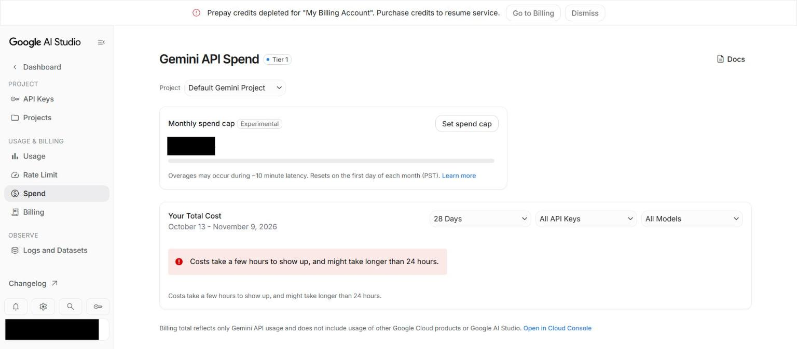

   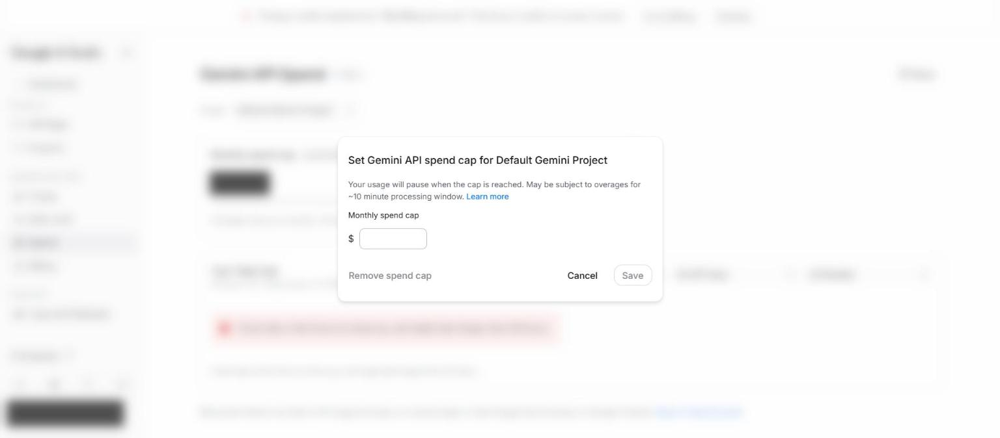

3. Open **Billing** and press **Buy credits**. Nothing is charged yet. The page says **Prepay** and **Auto-reload: Off**.

   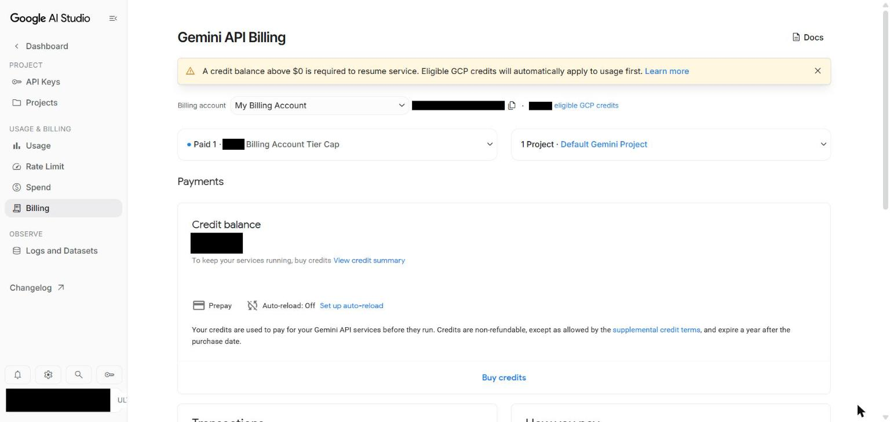

4. **Google preselects $20. Choose $5** unless you want more: $5 is the smallest purchase, and the most you can hold is $5,000.

   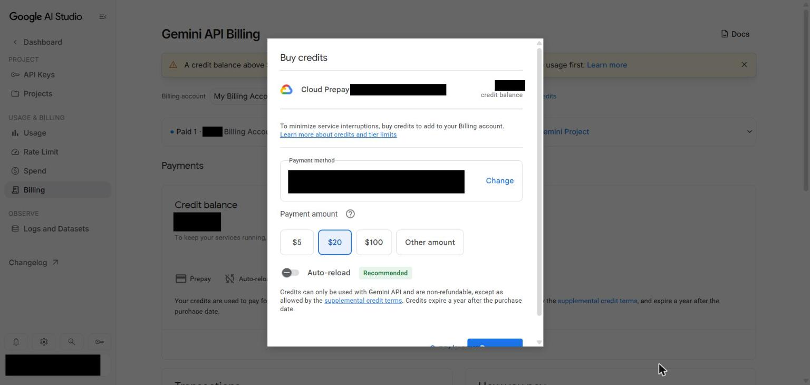

5. **Leave Auto-reload off.** It carries a green *Recommended* label, but it is the one setting that charges your card by itself. Check the payment method, then press **Pay now**. Credit can't be refunded and expires after 12 months.

   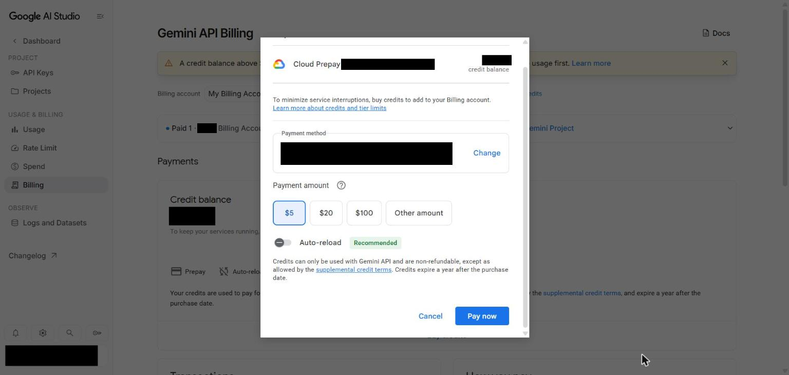

6. Reload the **Billing** page. If it says *Failed to load data*, reload again. You should see the balance, **Auto-reload: Off**, one entry under **Transactions**, and the yellow warning gone.

   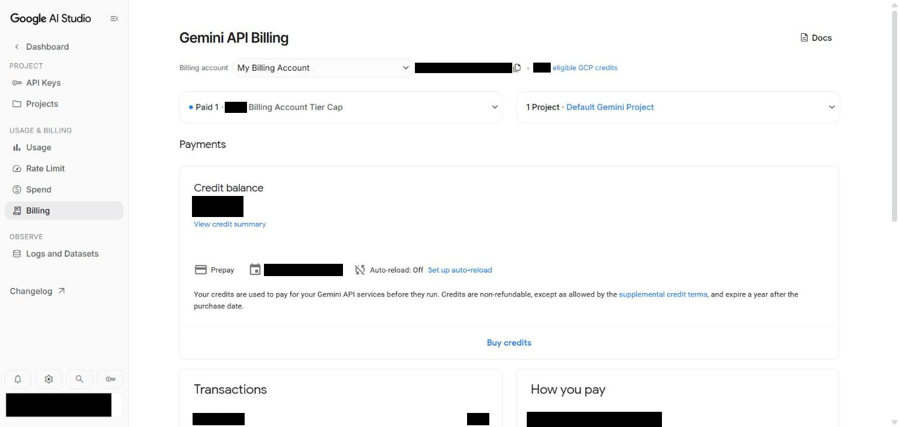

**What can charge your card,** as Google's [billing page](https://ai.google.dev/gemini-api/docs/billing) describes it: buying credits, each time you do it; auto-reload, if you turn it on; and other Google Cloud products on the same billing account, billed monthly. On Prepay, running out of balance stops the API with an error rather than charging your card. A small overrun can take your balance below zero, and comes off your next purchase. Check that your Billing page says **Prepay**: on Postpay you are billed monthly for what you use.

### Create a key

1. Open [Google AI Studio's key page](https://aistudio.google.com/apikey) and sign in with your Google account. The first time, accept the terms. With several Google accounts in one browser, check the account shown is the one you mean: each has its own keys.

   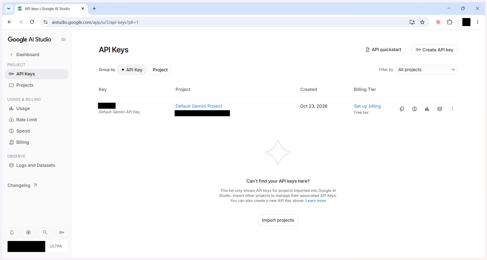

2. If a key is listed already, you can use it. To make another, press **Create API key**, give it a name you will recognise, such as *FilmOpen*, choose the project, and press **Create key**.

   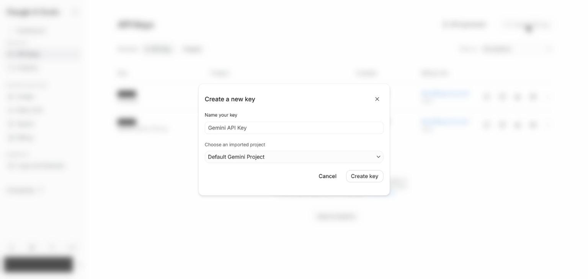

3. Press the copy button on the key's row, and keep the key somewhere safe, such as a password manager, until you add it to FilmOpen. The row shows the key's project and its billing tier.

   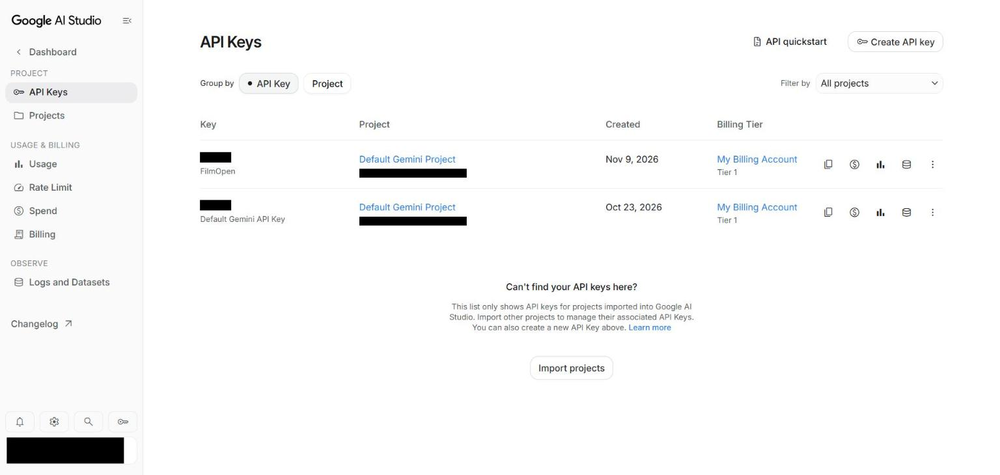

### Add the key to FilmOpen

FilmOpen keeps your key on this device, encrypted in your operating system's credential store, for your user only. It never puts the key in a project or in its log, never shows it again apart from its last four characters, and sends it only to Google. Plugins run in FilmOpen's desktop app, so add the key there.

1. In FilmOpen, open **Settings**, choose **Plugins**, and press **Configure** on the **Google** row. If it isn't turned on yet, [install and allow it](/docs/guides/plugin-packages/#install-and-allow) first.
2. On the **Google AI Studio key** card, paste your key into the **API key** box and press **Save**. FilmOpen asks Google about the key before it saves anything, and the card says so while it waits. If what you pasted looks like another platform's key, a line under the box says so and *Save* asks first.
3. A green **Key was accepted** appears under the box, the box empties, and the card says **Verified on** the date, with the key's last four characters. FilmOpen saves no key Google did not accept.

   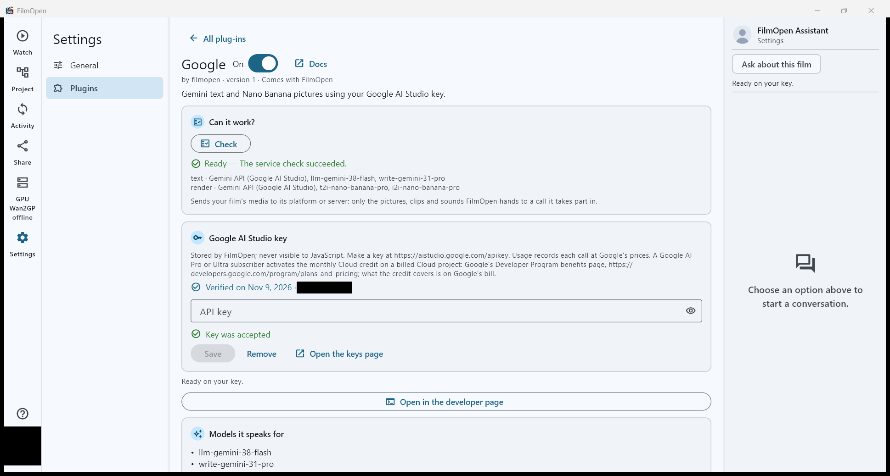

**If the card says something else:**
- **Key is invalid:** Google refused the key, so nothing was saved and the box keeps it. Check that you copied all of it, or create a new key.
- **Could not check:** Google didn't answer in time, couldn't be reached, or answered with an error. Nothing was saved, and the box keeps the key: press **Save** again when the connection is back.
- **Saving this key could not be confirmed:** the box keeps the key. Press **Save** to try again, and if it keeps happening, restart FilmOpen.

**Save** checks the key with Google before it stores anything, without running a model. **Remove** takes the key out of FilmOpen after asking, and the key keeps working on Google until you delete it there.

After pasting a key anywhere, clear your clipboard history if your system keeps one: on Windows, press Win+V and choose **Clear all**.

### Keep the key safe

- **Anyone with your key can use your account's allowance or spend your credits.** Never put the key in a chat, an e-mail, a shared document or code.
- **If it may have leaked,** delete it on the key page and create a new one.

### Use a Google AI plan's credit

If you pay for Google AI Pro or Ultra, the plan includes a monthly credit for developers, which Google says pays for Gemini API calls, those made through your key included. Google doesn't switch it on for you: you claim it once, and on Prepay you also need at least $5 of prepaid credit (see [Add money](#add-money)).

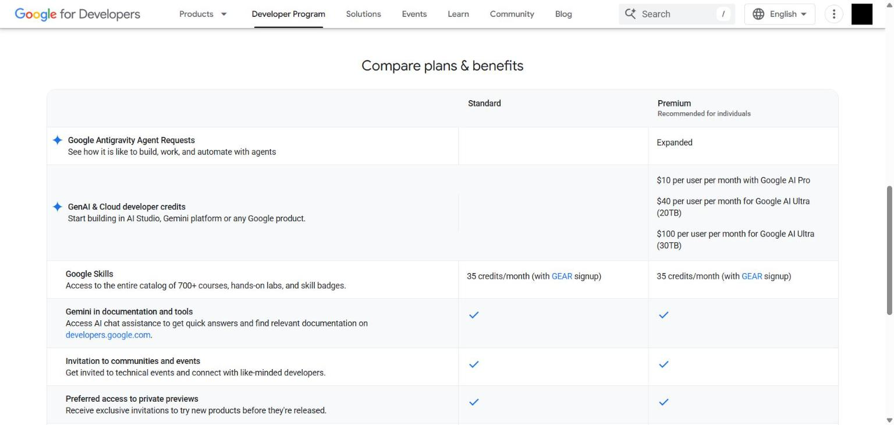

1. Open [your Benefits page](https://me.developers.google.com/benefits), signed in with the Google account that pays for the plan. If it says **Join the program**, press it: standard membership is free. Then **reload the page**, since the credit may not appear until you do. If it says **Unlock Google AI Pro or Ultra**, reload, and check you are on the right account.

   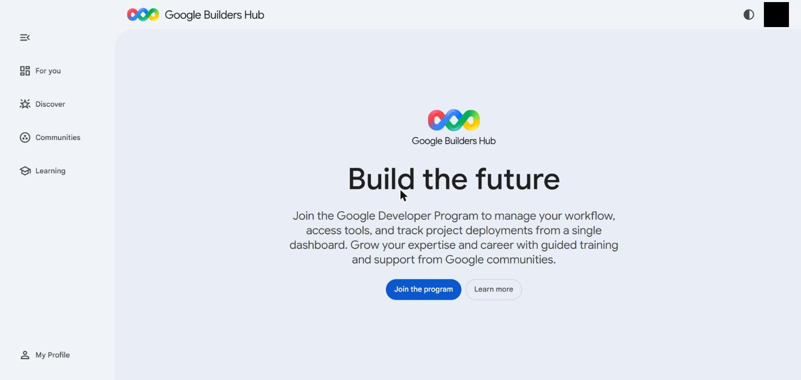

2. On the card named for your credit, choose your billing account under **Billing account**. If you have none, create one first in AI Studio's **Billing** page.

   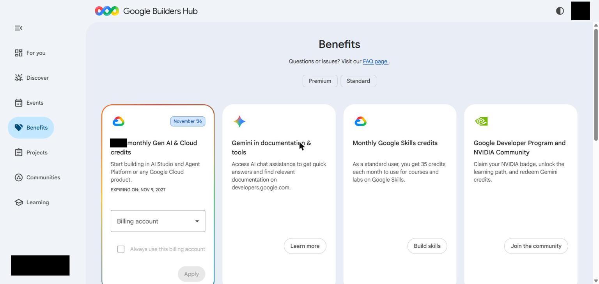

   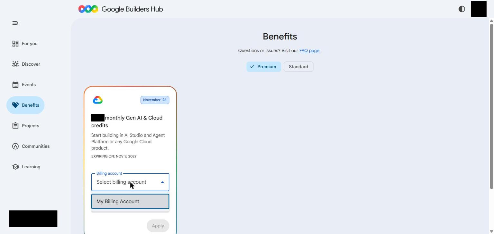

3. Tick **Always use this billing account**, so each month's credit applies by itself; otherwise you come back and claim it every month. Press **Apply**. Claiming costs nothing.

   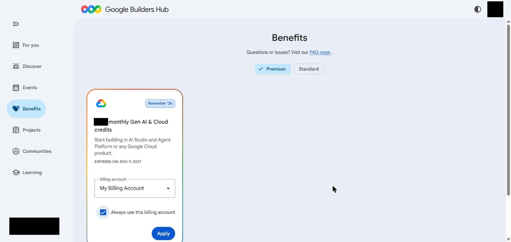

4. The card now shows **Remaining balance** and a **Google Cloud Billing** button.

   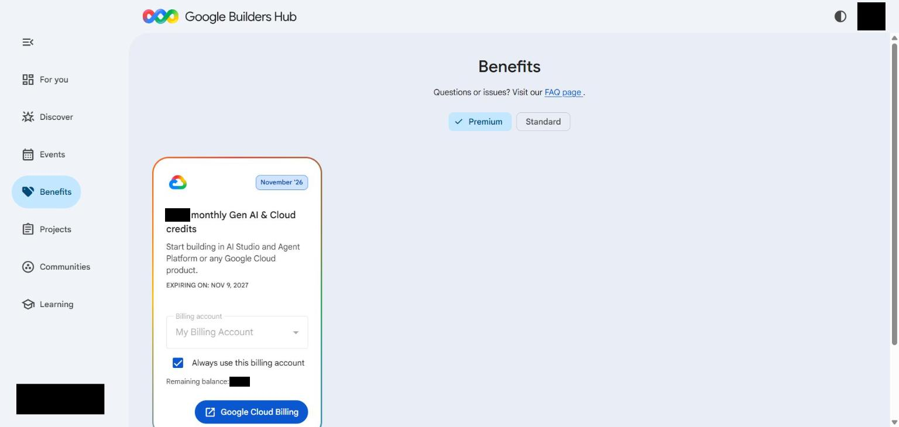

5. Open AI Studio's **Billing** page and reload it. It should say **$100 eligible GCP credits**, or $10 or $40 for your plan. The warning about a balance above $0 stays until you have bought your $5.

   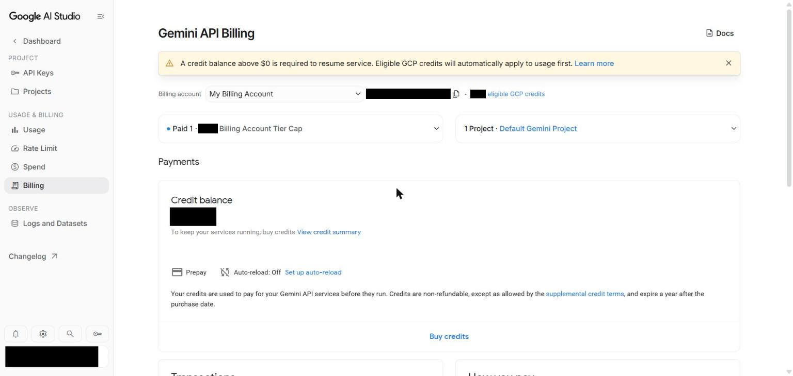

Google's own words for the $5 rule, and for the plan's credit being used first:

Google says that if your prepaid balance reaches $0, the plan's credit stops working on the API too. Your $5 expires after 12 months, so expect to buy another $5 about once a year. The credit is much smaller than the plan's price, and separate from what the plan gives you in the Gemini app. Your Google AI plan itself is changed or cancelled in your Google One settings.

## The plugin

**fo-google** gives FilmOpen Gemini for text and Nano Banana for pictures, on your AI Studio key. Turn the plugin on in **Settings → Plugins**; [Installing plugins](/docs/guides/plugin-packages/) explains installing and allowing one. Its page is opened with **Configure** on its row, and **Check** under **Can it work?** asks the platform about your key without making anything.

**Text.** The plugin streams Gemini's answer, shows its thoughts as notes, and can use tools. A request runs once, with no retry; the free tier's "too many requests" answer is shown as it comes.

**Pictures.** A render makes one picture. If Google refuses the picture for safety reasons you are told why, and the tokens you used are still counted. The seed is not applied, so a saved seed doesn't promise the same result again.

**Cost.** Usage records each call at Google's published price. Google's free-tier and subscriber credit are not recorded; what they cover is on Google's bill.

## If something goes wrong

- **"You do not have permission to create a key in this project":** ask whoever owns the Google Cloud project, or choose another.
- **Requests are refused for "too many requests":** you have reached the free tier's limit. Wait, or turn on billing.
- **Requests fail with payment needed, or you see "Prepay credits depleted":** your prepaid balance has reached zero, even if you have never bought any. Buy credits in AI Studio. Google says a plan's credit doesn't count until you have.
- **Gemini 3.1 Pro, Gemini 4 or Nano Banana is refused:** they need a billing account, since they aren't on the free tier.
- **FilmOpen says the key is invalid, or that it could not check it:** nothing was saved and the box keeps the key. See [Add the key to FilmOpen](#add-the-key-to-filmopen).
