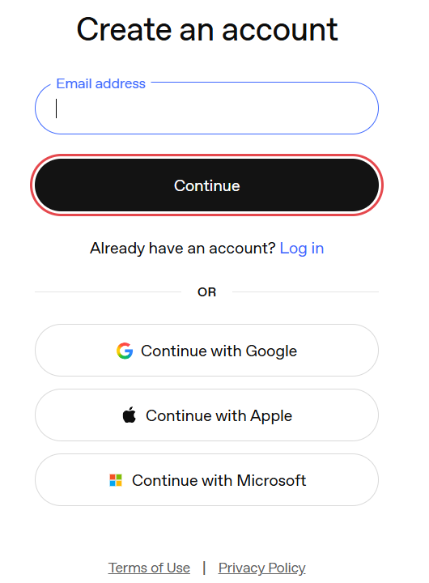
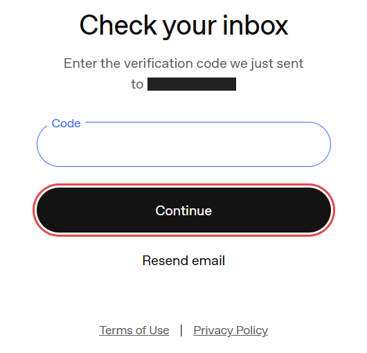
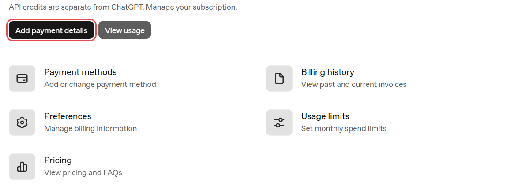
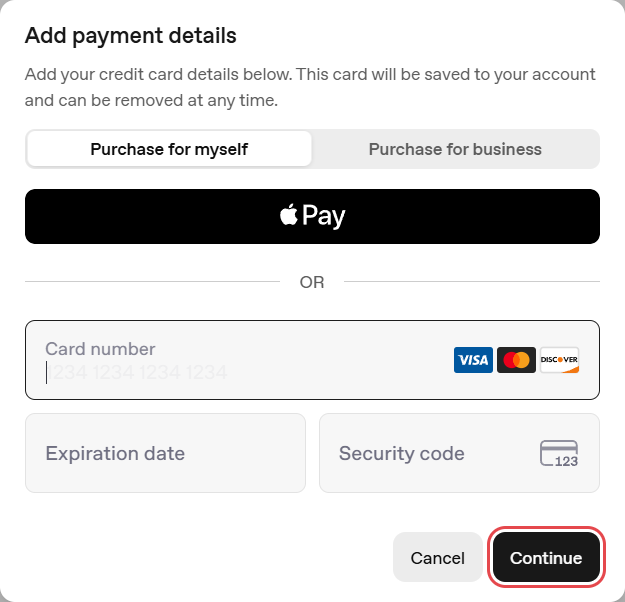
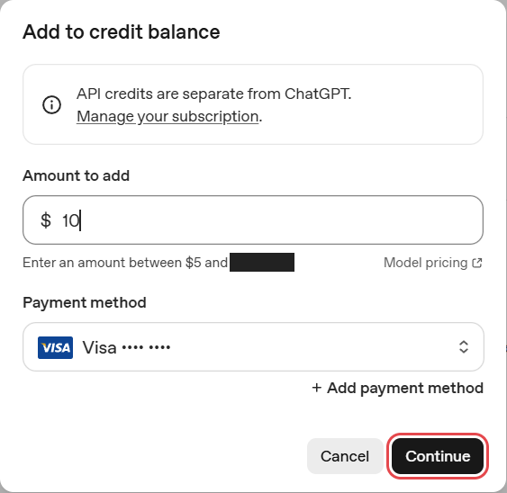
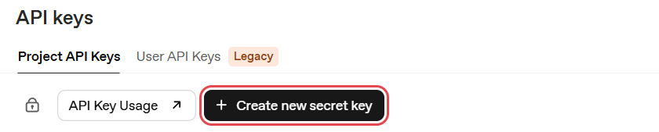
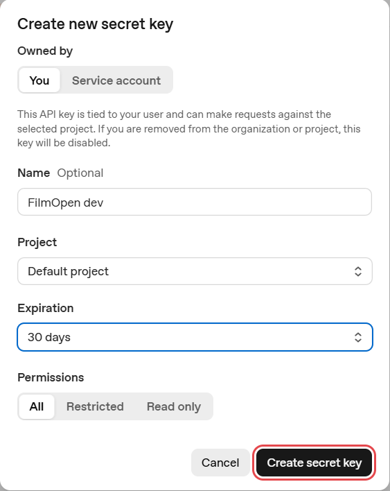
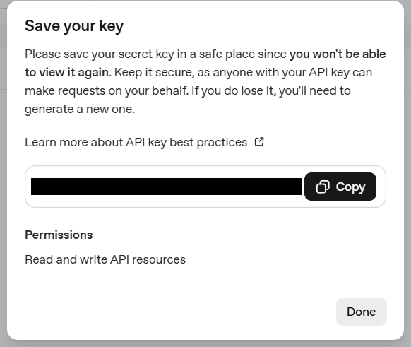
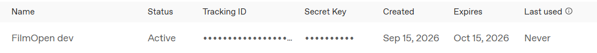

- [What it is and what FilmOpen uses it for](#what-it-is-and-what-filmopen-uses-it-for)
- [Pricing](#pricing)
- [FilmOpen credit](#filmopen-credit)
- [Create your own key](#create-your-own-key)
- [The plugin](#the-plugin)
- [If something goes wrong](#if-something-goes-wrong)

Implemented in plugin [`fo-openai`](#the-plugin).

## What it is and what FilmOpen uses it for

OpenAI makes the GPT models. FilmOpen uses it for images, for writing, for reading pictures, and for turning your voice into text as you speak.

| Model | What it does in FilmOpen |
|---|---|
| GPT Image 2.5 | Makes an image from a prompt |
| GPT-5.6 Terra | Writes and reads text for the assistant, including structured data and tools |
| GPT-6 Astra | Describes a picture's style, and a character's reference picture |
| GPT-Live-Transcribe | Turns your speech into text while you talk |

**Writing can run three ways.** FilmOpen uses the first of these you have set up, in this order: your [**ChatGPT sign-in**](#or-sign-in-with-chatgpt), your own [**Codex**](#or-use-codex) program, then your **OpenAI key** or FilmOpen credit. A call stays on the route it started on: if it is refused it ends there, and never moves to one that costs money. Images, analyses and dictation use the key or FilmOpen credit only.

Editing a picture from a reference is done on [fal](/docs/platforms/fal/). The [technical notes](/docs/platforms/openai-notes/) cover OpenAI's API in more depth.

## Pricing

OpenAI is prepaid: you buy credit before you use the API.
- **Buying credit.** The smallest purchase is $5, and $10 is filled in. Credit expires a year after you buy it and is not refunded, apart from a few exceptions such as billing errors. Your account's trust tier sets the most credit it can hold ([prepaid billing](https://help.openai.com/en/articles/8264644-how-can-i-set-up-prepaid-billing)).
- **Fees and tax.** OpenAI's billing pages mention no fee for buying credit. Tax is charged on top of its prices where the law requires ([Services Agreement](https://cdn.openai.com/osa/openai-services-agreement.pdf), §6.3), and your billing details can carry a tax or VAT ID ([tax and VAT IDs](https://help.openai.com/en/articles/9038389-updating-billing-information-tax-id-and-vat-id)).

| Model | Standard price |
|---|---|
| GPT-Live-Transcribe | $0.017 per minute of audio |
| GPT-5.6 Terra | $2 per million input tokens, $12 per million output tokens; $4 and $18 above 272,000 input tokens |
| GPT-6 Astra | $10 per million input tokens, $1 cached, $50 output (for analyses, FilmOpen's estimate from the tokens used) |
| GPT Image 2.5 | $5 per million text tokens in, $30 per million image tokens out |

- **With a ChatGPT sign-in,** writing comes out of your ChatGPT plan's allowance, not your API credit. **With Codex,** it is billed however you signed Codex in: to your ChatGPT plan, or to your own OpenAI key. Either way FilmOpen charges nothing for those turns, and Usage records the tokens OpenAI reports, labelled **ChatGPT plan** (or **OpenAI key in Codex**, where Codex is signed in with a key), without a dollar price. On 9 November 2026 OpenAI's Codex page listed Plus at $20 a month and Pro from $100 a month ([plans](https://learn.chatgpt.com/codex/pricing)).
- **Batch requests:** they come back later and cost half.
- **Usage tiers:** new accounts start at Tier 1 once they have paid $5. Tier 1 allows up to $100 of usage a month, and the limit rises as your spending grows ([rate limits](https://developers.openai.com/api/docs/guides/rate-limits)).

Prices are from FilmOpen's catalogue on 9 November 2026, GPT-6 Astra's from the plugin's rates of 22 September 2026. See [OpenAI's pricing](https://developers.openai.com/api/docs/pricing) for today's.

## FilmOpen credit

You can use FilmOpen credit instead of your own OpenAI key: FilmOpen can make images, write, describe pictures and transcribe your voice through OpenAI on your balance. Where a ChatGPT sign-in or Codex is set up, writing uses that first, at no FilmOpen charge.

**Top up your FilmOpen account on filmopen.ai.** FilmOpen passes on OpenAI's actual rate and charges 8% plus the payment processor's fees when you top up.

With no OpenAI key of your own saved, the plugin's page says **Ready on FilmOpen credit.** once you are signed in and have a balance; **Sign in to filmopen.ai to use FilmOpen credit.** or **FilmOpen credit: top up on filmopen.ai.** say what is missing. A key of your own wins: once you save one, FilmOpen uses it and OpenAI bills you directly.

## Create your own key

These steps open an OpenAI account of your own and put its key into FilmOpen. The screenshots of OpenAI were taken on its site on 15 September 2026. Some steps weren't tried then: finishing a first payment, what follows *Continue* when buying more credit, auto-reload, a monthly limit, two-factor sign-in, the phone check and deleting a key. Those follow OpenAI's help centre and developer documentation, or what its console showed.

### Before you start

You need:
- an e-mail address, where OpenAI sends a sign-up code, or a Google, Microsoft or Apple account ([sign-in methods](https://help.openai.com/en/articles/4936824-can-i-change-how-i-log-into-my-account-authentication-method));
- a phone that can receive a code by SMS, or by WhatsApp where OpenAI offers it. OpenAI asks for it before your first key, but not to sign up ([phone verification](https://help.openai.com/en/articles/8983040-what-does-phone-verification-look-like));
- a credit or debit card for credit.

**For GPT Image 2.5,** OpenAI may ask for organisation verification before first use: a business check, an identity check with a government-issued ID and, if asked, a selfie, or both ([image generation](https://developers.openai.com/api/docs/guides/image-generation), [organisation verification](https://help.openai.com/en/articles/10910291-api-organization-verification)).

**Countries.** OpenAI's API is available in [these countries](https://developers.openai.com/api/docs/supported-countries).

### Create an account

1. Open [OpenAI's sign-up page](https://platform.openai.com/signup). Type your e-mail address and press **Continue**, or press **Continue with Google**, **Continue with Apple** or **Continue with Microsoft**.

   

2. OpenAI e-mails you a code. Type it into **Code** and press **Continue**. If no e-mail arrives, press **Resend email**.

   

That is the whole sign-up: OpenAI asked for no password, name or birthday. You land on the platform's **Home** page, in an organisation called *Personal* with a project called *Default project*.

**Turn on two-factor sign-in.** Anyone who gets into your account can create keys and spend your credit. OpenAI's help centre says you can turn it on in ChatGPT, under **Settings → Security**, or in the API platform, with an authenticator app, push notifications or a text message. It then protects both ChatGPT and the API platform ([multi-factor authentication](https://help.openai.com/en/articles/7967234-enabling-or-disabling-multi-factor-authentication-mfa)).

### Add money

The API is paid for in advance, and a ChatGPT subscription doesn't pay for it, as the Billing page points out.

1. Open the menu at the bottom of the sidebar, choose **Organization settings**, then **Billing** ([Billing](https://platform.openai.com/settings/organization/billing/overview)).
2. If OpenAI has no card of yours yet, press **Add payment details**.

   

3. Choose **Purchase for myself**, or **Purchase for business** if a company is paying. Enter your card, or use Apple Pay where it is offered, and press **Continue**.

   

4. **Your first purchase.** Choose how much credit to buy: at least $5, with $10 filled in. **Use auto-reload** is on at this step: turn it off unless you want OpenAI to buy more credit by itself whenever your balance runs low. If you keep it on, set the balance that starts a reload, the balance to restore and, if you like, a monthly limit on reloads. Then confirm the purchase. Your balance can take a few minutes to update ([prepaid billing](https://help.openai.com/en/articles/8264644-how-can-i-set-up-prepaid-billing)).
5. **Buying more later.** Press **Buy credits** on the Billing page. Type the amount under **Amount to add** (the window shows the range your account can add), check the card under **Payment method**, press **Continue** and finish paying. The credit shows as **API credit balance** on the Billing page.

   

6. **Auto-reload, later.** The Billing page's **Auto-reload credits** shows whether it is on, and **Manage auto-reload** changes it. Its monthly limit caps automatic purchases, not what the API spends ([prepaid billing](https://help.openai.com/en/articles/8264644-how-can-i-set-up-prepaid-billing)).
7. **A monthly limit.** **Usage limits**, on the Billing page, sets monthly spend limits. Once a limit is reached, OpenAI refuses API requests ([spend limits](https://developers.openai.com/api/docs/guides/spend-limits)). Don't treat your balance as an instant stop: usage is counted with a delay, so a balance can dip below zero, and the difference comes off your next purchase ([prepaid billing](https://help.openai.com/en/articles/8264644-how-can-i-set-up-prepaid-billing)).

### Create a key

1. In the sidebar, open **API Keys** and press **Create new secret key**. The first time, OpenAI asks you to verify a phone: choose your country, enter the number, and type the code it sends by SMS, or by WhatsApp where available. Later keys don't ask ([phone verification](https://help.openai.com/en/articles/8983040-what-does-phone-verification-look-like)).

   

2. Fill in the form, then press **Create secret key**:
   - **Owned by:** leave **You**. OpenAI disables the key if you are ever removed from the organisation or the project.
   - **Name:** one you will recognise, such as *FilmOpen dev*.
   - **Project:** leave **Default project**, unless you made a project for FilmOpen.
   - **Expiration:** 1 day, 7 days, 30 days, Never or Custom. **Create secret key** stays greyed out until you choose. A key that expires does less harm if it leaks, but on that day FilmOpen stops working with it and you need a new one. An administrator can also require keys to expire within a set time ([changelog](https://developers.openai.com/api/docs/changelog)).
   - **Permissions:** **All**, which OpenAI describes as reading and writing API resources. **Restricted** and **Read only** narrow what the key can do.

   

3. **Save your key** shows the key this once: OpenAI cannot show it to you again. Press **Copy** and keep the key somewhere safe, such as a password manager, until you add it to FilmOpen. Then press **Done**.

   

4. The key joins the list, with the day it expires.

   

### Add the key to FilmOpen

FilmOpen keeps your key on this device, encrypted in your operating system's credential store, for your user only. It never puts the key in a project or in its log, never shows it again apart from its last four characters, and sends it only to OpenAI. Plugins run in FilmOpen's desktop app, so add the key there.

1. In FilmOpen, open **Settings**, choose **Plugins**, and press **Configure** on the **OpenAI** row. If it isn't turned on yet, [install and allow it](/docs/guides/plugin-packages/#install-and-allow) first.
2. On the **OpenAI key** card, paste your key into the **API key** box and press **Save**. FilmOpen asks OpenAI about the key before it saves anything, and the card says so while it waits. If what you pasted looks like another platform's key, a line under the box says so and *Save* asks first.
3. A green **Key was accepted** appears under the box, the box empties, and the card says **Verified on** the date, with the key's last four characters. FilmOpen saves no key OpenAI did not accept.

**If the card says something else:**
- **Key is invalid:** OpenAI refused the key, so nothing was saved and the box keeps it. Check that you copied all of it, or create a new key.
- **Could not check:** OpenAI didn't answer in time, couldn't be reached, or answered with an error. Nothing was saved, and the box keeps the key: press **Save** again when the connection is back.
- **Saving this key could not be confirmed:** the box keeps the key. Press **Save** to try again, and if it keeps happening, restart FilmOpen.

**Save** checks the key with OpenAI before it stores anything, without running a model. **Remove** takes the key out of FilmOpen after asking, and the key keeps working on OpenAI until you delete it there.

After pasting a key anywhere, clear your clipboard history if your system keeps one: on Windows, press Win+V and choose **Clear all**.

### Keep the key safe

- **Anyone with your key can use it,** and OpenAI bills you for what they do. Never put the key in a chat, an e-mail, a shared document or code.
- **If it may have leaked,** delete it with the bin at the end of its row on the API keys page, then create a new one.
- **Cap what it can cost:** set a monthly limit and keep auto-reload off (see *Add money*).
- **Let it expire,** so a forgotten key stops working by itself.
- **Turn on two-factor sign-in** (see *Create an account*).

### Or sign in with ChatGPT

For writing only, you can use an eligible ChatGPT Plus or Pro plan instead of a key. OpenAI controls who is eligible and the limits.

1. In FilmOpen, open **Settings**, choose **Plugins**, and press **Configure** on the **OpenAI** row.
2. On the **ChatGPT** card, press **Sign in** and finish in your browser. The card then says **Signed in as** your account.
3. **Sign out** on the same card ends it on this device. FilmOpen stores and refreshes the sign-in for you, in your operating system's credential store.

### Or use Codex

For writing only, FilmOpen can run your own copy of Codex, OpenAI's coding program.

1. Install Codex from [OpenAI's quickstart](https://learn.chatgpt.com/codex/quickstart) and sign in to it yourself, with ChatGPT or a key.
2. On the plugin's page, choose its program under **Codex program**.

**Codex runs as you.** It may read files and run read-only commands on this computer; your project is changed only through FilmOpen's tools. It also has any MCP tools you have configured, which may act outside that read-only limit. Your chat stays in Codex's own history, named **FilmOpen —** and its opening words.

## The plugin

**fo-openai** puts every OpenAI service FilmOpen offers in one plugin. Turn the plugin on in **Settings → Plugins**; [Installing plugins](/docs/guides/plugin-packages/) explains installing and allowing one. Its page is opened with **Configure** on its row, and **Check** under **Can it work?** asks the platform about your key without making anything. With a ChatGPT sign-in it checks that account's models; otherwise it checks Codex where you have set it up and your key, and names each result. A working key doesn't promise every model, a balance, or the organisation verification a model may need. A ChatGPT subscription is not an API key: to use one, sign in on the **ChatGPT** card.

**Images.** GPT Image 2.5 makes one picture per request, from text only. The sizes, qualities and formats you can choose are the catalogue's. Before a render FilmOpen shows its estimate; afterwards Usage records OpenAI's reported token counts at the catalogue's prices, or an unknown cost where those are missing.

**Writing and reading.** The plugin offers a chat model to the assistant, on any of the three routes, and can call tools. On Codex, Stop ends the turn and records the tokens reported so far, or an unknown count where none arrived. Analyses send only the picture you chose, describe it, and show you the proposed fields to review. **Cancel** writes nothing. Each request runs once: a lost or timed-out answer is reported as uncertain, so check your OpenAI usage before trying again.

**Dictation.** Choose the service under **Settings → General → Speech service**. FilmOpen dictates with one service at a time.

## If something goes wrong

- **ChatGPT says your plan isn't eligible:** this route needs a Plus or Pro plan that OpenAI allows. A stored sign-in is tried first and a refused call ends there, so press **Sign out** on the card to use Codex or a key instead.
- **FilmOpen asks you to sign in to ChatGPT again:** your sign-in has lapsed. Press **Sign in** on the card.
- **Codex fails or isn't found:** check **Codex program** on the plugin's page, and that Codex is signed in. FilmOpen doesn't move a failed turn to another route.
- **"Oops! We couldn't add this payment method, please report this issue if it persists."** On 15 September 2026 a new account's card was turned down with this message at once, before its bank saw any charge. Developers on OpenAI's forum have reported failing cards, and payments that did not become credit, since 11 September 2026 ([forum thread](https://community.openai.com/t/adding-new-payment-method-broken-on-web-at-platform-api/1396741)). Try again later, or ask OpenAI's support through its [help centre](https://help.openai.com/).
- **A payment shows but no credit appears.** Don't pay again. A balance can take a few minutes to update ([prepaid billing](https://help.openai.com/en/articles/8264644-how-can-i-set-up-prepaid-billing)); if the payment is under Billing history and the credit still doesn't come, ask OpenAI's support.
- **"Failed to load credit balance."** A new account's Billing page said this on 15 September 2026, before any card was saved.
- **Create secret key is greyed out:** choose an **Expiration**.
- **You lost the key:** OpenAI cannot show it again. Create a new key and delete the old one.
- **The key stopped working:** look at **Expires** in its row, and at your credit on the Billing page. The [technical notes](/docs/platforms/openai-notes/) list the errors OpenAI returns.
- **FilmOpen says the key is invalid, or that it could not check it:** nothing was saved and the box keeps the key, so you can put it right and press *Save* again — see [Add the key to FilmOpen](#add-the-key-to-filmopen) for what each line means.
