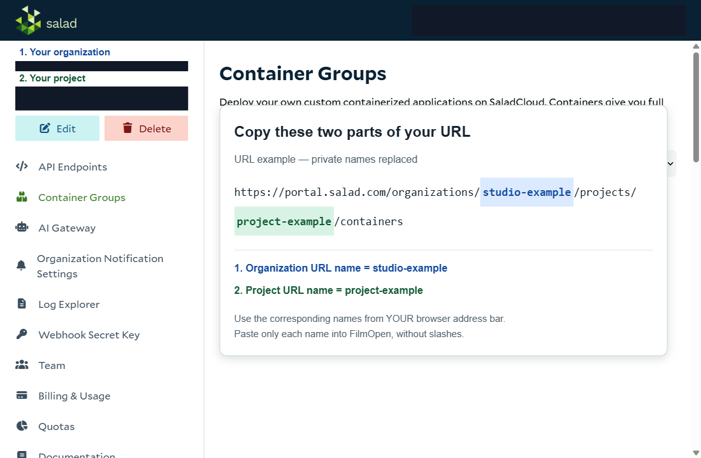

- [What it is and what FilmOpen uses it for](#what-it-is-and-what-filmopen-uses-it-for)
- [Pricing](#pricing)
- [FilmOpen credit](#filmopen-credit)
- [Create your own key](#create-your-own-key)
- [The plugin](#the-plugin)
- [If something goes wrong](#if-something-goes-wrong)

Implemented in plugin [`fo-salad`](#the-plugin).

## What it is and what FilmOpen uses it for

Salad rents out GPU computers by the hour. FilmOpen can start one for you, install ComfyUI on it, connect to it, and let you choose it in the render dialog, so you can render without a GPU of your own.

You work with two plugins: **SaladCloud servers** (`fo-salad`) starts and stops the rented computer, and [ComfyUI](/docs/platforms/comfyui/) (`fo-cui`) renders on it.

## Pricing

Salad charges for the server's running time, per second, while it is running: from $0.015 an hour for the smallest GPUs. For the GPUs a film needs, Salad's page listed an RTX 3090 from $0.09 to $0.20 an hour, an RTX 4090 from $0.16 to $0.44, and an RTX 5090 from $0.25 to $0.60, on 9 November 2026 ([pricing](https://salad.com/pricing/)).

- **Startup is charged.** Starting a server and downloading its models takes minutes and is paid running time. Measured first starts took 16 to 40 minutes for an 8 GB Z-Image Turbo server, so a first server can cost more than the picture.
- **A running server keeps charging.** See *If something goes wrong*.
- **Your balance.** On your own account, Salad's recharge is between $5 and $10,000, and credits expire 12 months after purchase. At a balance of zero, Salad shuts your servers down ([billing](https://docs.salad.com/general/explanation/billing.md)).

FilmOpen's compute-cost display is an estimate from the running time and the hourly price, not Salad's bill.

## FilmOpen credit

You can use FilmOpen credit instead of your own Salad account. On credit, FilmOpen creates the server on its Salad account and pays Salad out of your balance: this is **server compute**, sold by the running hour.

**Top up your FilmOpen account on filmopen.ai.** FilmOpen passes on Salad's actual rate and charges 8% plus the payment processor's fees when you top up.

**How the money works.** FilmOpen holds an hour of the quoted compute from your balance when the server starts. FilmOpen asks Salad to stop the server when your next hour can't be held, or after 81 minutes without a render or other work (a status read doesn't count). The hold limits what you are charged; the server's stop is confirmed from Salad's own state. A server that has stopped stays stopped.

The plugin's Organization and Project settings aren't needed on credit.

## Create your own key

These steps use a Salad account of your own. They were written from Salad's pages on 9 November 2026, without an account.

### Before you start

You need a Salad account and an organization and project in it. Salad's [quickstart](https://docs.salad.com/products/sce/getting-started/quickstart) walks through both.

### Create an account

Open the [Salad portal](https://portal.salad.com/) and sign up, then create an organization and a project.

### Add money

In the Portal, open **Billing & Usage** and press **Add Credits**: between $5 and $10,000, by card or Solana crypto. Credits expire 12 months after purchase ([billing](https://docs.salad.com/general/explanation/billing.md)).

### Create a key

1. In the portal, open your account's drop-down and choose **API Access**. Copy the key shown there: each user has one key at a time ([API usage](https://docs.salad.com/reference/api-usage)).
2. Keep it somewhere safe, such as a password manager, until you add it to FilmOpen.

### Add the key to FilmOpen

FilmOpen needs the organization and project names too, so set those first.

1. In FilmOpen, open **Settings**, choose **Plugins**, and press **Configure** on the **SaladCloud servers** row. Turn on **ComfyUI** too.
2. Under **Settings on this computer**, fill in **Organization URL name** and **Project URL name**. They are the names in your browser's address bar when you open the project in the portal: for `https://portal.salad.com/organizations/studio-example/projects/project-example/containers`, the organization is `studio-example` and the project is `project-example`. Copy yours, not the example. A title such as "My Studio" can differ from the name in the address.

   
3. On the **Salad API key** card, paste your key into the **API key** box and press **Save**. A check that passes means the key reaches that organization. It doesn't prove the project is right or that a server is free.

FilmOpen keeps your key on this device, encrypted in your operating system's credential store. It never puts the key in a project or in its log.

### Keep the key safe

- **Anyone with your key can start servers on your balance.** Never put it in a chat, an e-mail, a shared document or code.
- **If it may have leaked,** use **Change API Key** in the portal, then save the new key in FilmOpen.

## The plugin

**fo-salad** starts, watches and stops ComfyUI servers on Salad. Turn the plugin on in **Settings → Plugins**; [Installing plugins](/docs/guides/plugin-packages/) explains installing and allowing one. Its page is opened with **Configure** on its row, and **Check** under **Can it work?** asks the platform about your key without making anything.

**Starting a server.**
1. Open a character you can edit, use its reference-image add control and choose **Render**.
2. Under **Model**, choose **Z-Image Turbo** and press **Start server**. This reads what's available and doesn't rent a server yet.
3. Choose a GPU at the displayed hourly price, with enough VRAM for **8 GB Quality**.
4. Leave the inactivity timeout at **15 minutes**, or enter a whole number from **5 to 60**, and press **Deploy** once. FilmOpen asks Salad to start the computer, which can take several minutes and is paid running time.
5. Under **Runs on**, select the Salad server, and under **Way of running it**, choose **8 GB Quality**. Choose a resolution, enter a short prompt, and press **Render** once.

**Stopping.** Press **Stop** in FilmOpen's server panel, then open the project in the Salad portal and confirm the server is **stopped** with **zero active instances**. On your own account, closing the render window, closing FilmOpen, or turning a plugin off is not a stop. FilmOpen sets a shutdown deadline with Salad, renewed while you work, and that deadline is what stops the server when FilmOpen is gone; on credit, FilmOpen's watch does (see *FilmOpen credit*). On your own account, a server started and left *Starting* with FilmOpen closed keeps running until FilmOpen is opened again, or you stop it in the portal.

The supplied setup includes the Z-Image **8 GB Quality** and **24 GB Quality** models and others, but not **8 GB Fast**. Cloud rendering is still being checked: account and key setup can succeed while a render fails.

## If something goes wrong

| What you see | What to check |
|---|---|
| The address is only `/organizations` | Open an organization, then a project. The two names aren't on the starting page. |
| A rejected key check | Spelling comes from the address, not the display title. Check the organization before replacing the key. |
| Key verified, but the project can't be used | Check the project part of the address, and your access to it. Key checks only reach the organization. |
| No available servers | Wait and refresh. Capacity changes; an empty list doesn't mean your key is wrong. |
| Server starting for a long time | Setup downloads the models. Leave it supervised and watch the portal. |
| Connection lost or no image returned | Inspect the server in Salad and confirm its stop state. Don't submit a second paid job by itself. |

**Check for a stopped server when you finish.** Salad bills while it runs.
