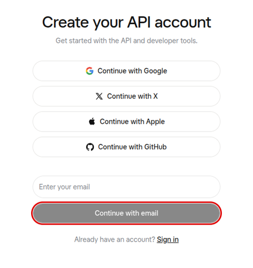
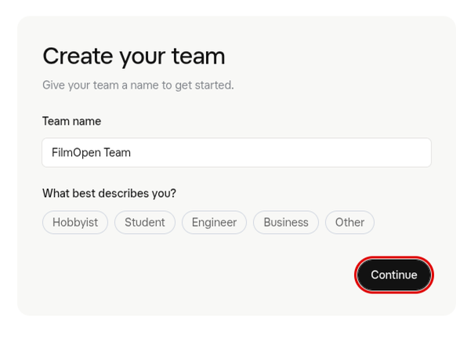
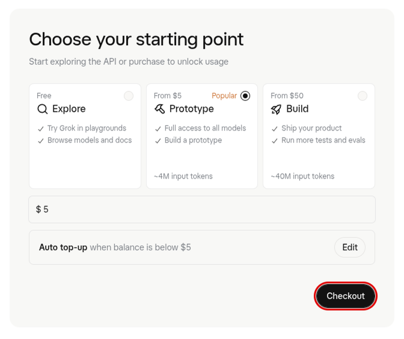
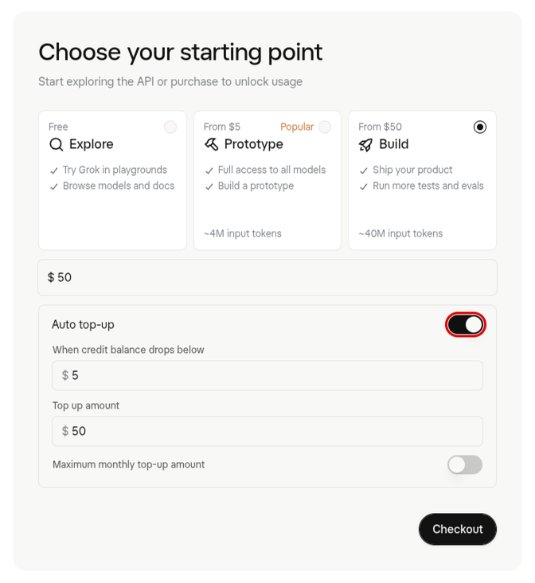
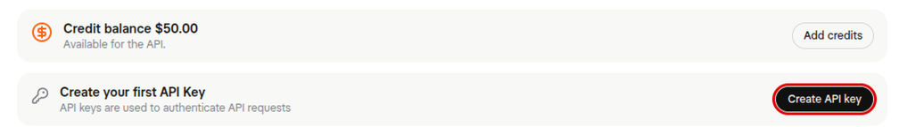
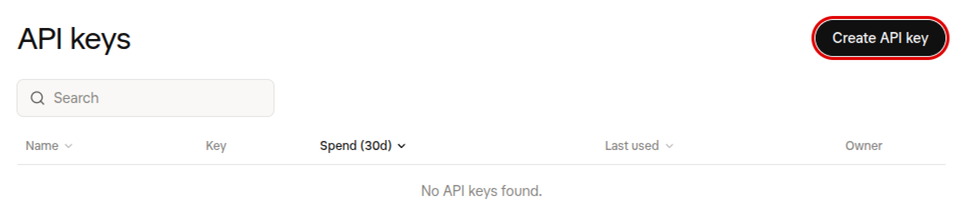
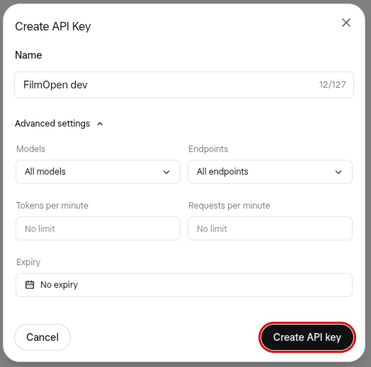
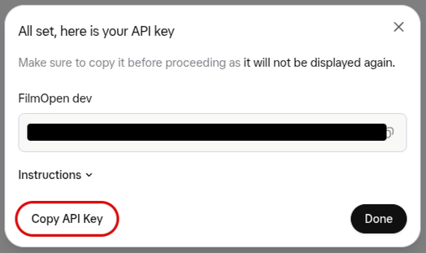

- [What it is and what FilmOpen uses it for](#what-it-is-and-what-filmopen-uses-it-for)
- [Sign in with Grok](#sign-in-with-grok)
- [Pricing](#pricing)
- [FilmOpen credit](#filmopen-credit)
- [Create your own key](#create-your-own-key)
- [The plugin](#the-plugin)
- [If something goes wrong](#if-something-goes-wrong)

Implemented in plugin [`fo-xai`](#the-plugin).

## What it is and what FilmOpen uses it for

xAI makes the Grok models. FilmOpen uses it for writing with Grok 4.7, pictures with Grok Imagine Image 2.0, clips from a first frame with Grok Imagine Video, and for turning your voice into text as you speak, at about a fifth of the price of OpenAI's dictation.

| Model | What it does in FilmOpen |
|---|---|
| Grok 4.7 | Writes and reads text, and can use tools, for the assistant |
| Grok Imagine Image 2.0 | Makes pictures from text or reference pictures on your Grok plan |
| Grok Imagine Video | Makes a clip from a first frame on your plan, own key or FilmOpen credit |
| grok-voice-transcribe-2.0 | Turns your speech into text while you talk, over xAI's live connection |

xAI's speech to text understands 25 languages, English, Spanish and Portuguese among them ([speech to text](https://docs.x.ai/developers/model-capabilities/audio/speech-to-text)).

**An OpenRouter key can't dictate with Grok.** OpenRouter lists xAI's speech to text, but only for a recording sent whole, not live as you speak, so FilmOpen needs a key from xAI itself.

The [technical notes](/docs/platforms/xai-notes/) cover xAI's API in more depth.

## Sign in with Grok

In **Settings → Plugins**, open **Configure** on **xAI**, then **Sign in** on the **Grok** card. Your browser opens xAI's consent page. It names xAI's shared client, also used by OpenCode and Hermes, rather than a FilmOpen client. Sign in with your own Grok account and approve access; FilmOpen receives the browser callback and the card shows the signed-in account. **Sign out** revokes access and clears the saved sign-in.

A SuperGrok or X Premium+ plan can supply text, pictures and clips through **xAI / Grok plan**. xAI controls availability and limits: some tiers receive a **403** refusal, whose words FilmOpen shows. A refusal never switches to your API key or FilmOpen credit. The price line says **through Grok plan**; it does not promise free use. Usage names the signed-in account and keeps tokens without a monetary charge. Provider-reported spending stays in the log.

Choose the plan route in **Settings → Models** or the render dialog. Text Automatic uses a stored sign-in before keys or credit. **Grok Build** remains an explicit program choice for someone who has configured it; Automatic and a new render do not choose that program by default. Dictation still needs your own xAI API key.

## Pricing

The API key and FilmOpen credit routes are separate from your Grok plan. On your own API key, xAI is prepaid: you buy credit before you use the API, and what you use is taken from your balance.
- **Buying credit is a one-off purchase, not a subscription.** You're charged when you buy the credit ([billing FAQ](https://docs.x.ai/docs/resources/faq-api/billing)), and xAI's invoice for it says *Single Purchase*. With the setting xAI starts you on, requests are refused once the credit is used up, rather than billed later ([billing](https://docs.x.ai/console/billing)).
- **Auto top-up is what can charge you again.** It is on at your first purchase unless you turn it off (see *Add money*).
- **Refunds.** xAI doesn't refund prepaid credit, except where the law requires it ([billing FAQ](https://docs.x.ai/docs/resources/faq-api/billing)). Its billing pages give no expiry date for credit.
- **Fees and tax.** xAI's prices are before tax, and its enterprise terms say you pay any card-processing fee as well ([terms](https://x.ai/legal/terms-of-service-enterprise), *Fees, Payment, and Taxes*).

| Model | Standard price |
|---|---|
| Grok 4.7 | $2 per million input tokens, $6 per million output tokens; $4 and $12 for a prompt of 200,000 tokens or more |
| grok-voice-transcribe-2.0, live | $0.20 an hour of audio, about $0.0033 a minute |

At that price, $5 of credit is about 25 hours of dictation and $50 about 250. OpenAI's GPT-Live-Transcribe costs $0.017 a minute, about five times as much.

- **Usage tiers:** a team starts at Tier 0 and moves up by what it has paid xAI: Tier 1 from $50, Tier 2 from $250. A tier never goes back down. For speech to text, Tier 0 allows 100 sessions at once and Tier 1 allows 200, far more than one person dictating needs ([rate limits](https://docs.x.ai/developers/rate-limits)).

Prices were checked on 18 September 2026; Grok 4.7's is FilmOpen's catalogue price on 9 November 2026. See [xAI's pricing](https://docs.x.ai/developers/pricing) for today's.

## FilmOpen credit

You can use FilmOpen credit instead of your own xAI key: FilmOpen can write with Grok 4.7 through xAI on your balance.

**Top up your FilmOpen account on filmopen.ai.** FilmOpen passes on xAI's actual rate and charges 8% plus the payment processor's fees when you top up.

With no xAI key of your own saved, the plugin's page says **Ready on FilmOpen credit.** once you are signed in and have a balance; **Sign in to filmopen.ai to use FilmOpen credit.** or **FilmOpen credit: top up on filmopen.ai.** say what is missing. A key of your own wins: once you save one, FilmOpen uses it and xAI bills you directly. Dictation with Grok takes your own xAI key: on credit, FilmOpen dictates through OpenAI instead.

## Create your own key

These steps open an xAI account of your own and put its key into FilmOpen. The screenshots of xAI were taken in its console on 18 September 2026, where the console calls itself the *SpaceXAI Console*. Some steps weren't photographed: the e-mail code at sign-up, finishing a card payment, and deleting a key. Those follow xAI's documentation or what its console showed.

### Before you start

You need:
- a Google, X, Apple or GitHub account, or an e-mail address, where xAI may send a code to check it's yours;
- a card (Visa, Mastercard or Discover) or Cash App Pay, for credit.

### Create an account

1. Open [xAI's sign-up page](https://console.x.ai/login?mode=sign-up). Press **Continue with Google**, **Continue with X**, **Continue with Apple** or **Continue with GitHub**, or type your e-mail address and press **Continue with email**. Continuing means agreeing to xAI's Terms of Service and Privacy Policy, as the page says.

   

2. If you signed up by e-mail, xAI may ask for a code it sends you: type it in to go on.
3. **Create your team.** Type a **Team name**, such as *FilmOpen*, choose what best describes you (**Hobbyist**, **Student**, **Engineer**, **Business** or **Other**) and press **Continue**. Your keys and your credit belong to the team.

   

### Add money

1. **Choose your starting point.** The three cards only fill in an amount:
   - **Explore**, free: look around the playgrounds and the documentation. The API refuses requests until you have credit.
   - **Prototype**, from $5, filling in $5.
   - **Build**, from $50, filling in $50.

   What you pay is the amount in the box under the cards, and you can type another. The *~4M input tokens* and *~40M input tokens* on the cards are for xAI's text models, not dictation.

   

2. **Decide about auto top-up before you pay.** The line under the amount reads **Auto top-up when balance is below $5**: it is on. Press **Edit** to see it:
   - **When credit balance drops below:** $5 filled in.
   - **Top up amount:** it follows the amount you buy, so with **Build** it is $50, charged again each time your balance drops below $5.
   - **Maximum monthly top-up amount:** off, so nothing caps what it spends in a month. xAI's only other limit is 200 top-ups in 24 hours ([billing](https://docs.x.ai/console/billing)).

   Turn **Auto top-up** off unless you want xAI to buy credit by itself. If you keep it on, lower the top-up amount or switch on a monthly maximum. xAI's own advice is to keep it on, so that the API never stops mid-task. It can be turned off at any time ([billing](https://docs.x.ai/console/billing)).

   

3. Press **Checkout**. On **Purchase your first credits**, choose **Card** or **Cash App Pay**. For a card, enter its number, expiry date and security code, your country and ZIP code, and press **Pay** with your amount. The page reminds you that a card given here can be charged again, which is how auto top-up pays.

   

4. You land on the console's dashboard, with your **Credit balance**. Its **Create API key** button, outlined, is where *Create a key* below begins.

   

5. **Later: the Billing page.** It is under your team's settings ([Billing](https://console.x.ai/team/default/billing)), and it shows your credit and whether auto top-up is on. **Enable auto top-up** turns it on, **Add credits** buys more, **Redeem promo code** takes a code, and further down, **Invoices** lists every purchase.

   

### Create a key

1. In the sidebar, open **API Keys** ([API keys](https://console.x.ai/team/default/api-keys)) and press **Create API key**. Don't confuse it with **Management Keys**, under the team's settings, which manage the account rather than call models.

   

2. Fill in the form, then press **Create API key**:
   - **Name:** one you will recognise, such as *FilmOpen dev*.
   - **Advanced settings** holds the rest, and can be left as it is:
     - **Models:** **All models**. The list offers only Chat, Image and Video, with no speech model, so narrowing it could leave out the one FilmOpen dictates with.
     - **Endpoints:** **All endpoints**. The list includes **Voice**, which FilmOpen's dictation needs. This guide's key was made with all of them, and a key narrowed to Voice alone hasn't been tried with FilmOpen.
     - **Tokens per minute** and **Requests per minute:** no limit.
     - **Expiry:** **No expiry**, or a date. A key that expires does less harm if it leaks, but on that day FilmOpen stops dictating with it and you need a new one.

   

3. **All set, here is your API key** shows the key this once: xAI won't show it again. Press **Copy API Key** and keep the key somewhere safe, such as a password manager. Then press **Done**. The key starts with `xai-`.

   

4. The key joins the list with its name, the first and last characters of the key, what it has spent in 30 days and when it was last used.

   

### Add the key to FilmOpen

FilmOpen keeps your key on this device, encrypted in your operating system's credential store, for your user only. It never puts the key in a project or in its log, never shows it again apart from its last four characters, and sends it only to xAI. Plugins run in FilmOpen's desktop app, so add the key there.

1. In FilmOpen, open **Settings**, choose **Plugins**, and press **Configure** on the **xAI** row. If it isn't turned on yet, [install and allow it](/docs/guides/plugin-packages/#install-and-allow) first.
2. On the **xAI key** card, paste your key into the **API key** box and press **Save**. FilmOpen asks xAI about the key before it saves anything, and the card says so while it waits. If what you pasted looks like another platform's key, a line under the box says so and *Save* asks first.
3. A green **Key was accepted** appears under the box, the box empties, and the card says **Verified on** the date, with the key's last four characters. FilmOpen saves no key xAI did not accept.

4. **To dictate with Grok,** open **Settings → General** and choose **xAI (Grok)** under **Speech service**. OpenAI stays the service until you do, and a dictation already under way keeps its service.

**If the card says something else:**
- **Key is invalid:** xAI refused the key, so nothing was saved and the box keeps it. Check that you copied all of it, or create a new key.
- **Could not check:** xAI didn't answer in time, couldn't be reached, or answered with an error. Nothing was saved, and the box keeps the key: press **Save** again when the connection is back.
- **Saving this key could not be confirmed:** the box keeps the key. Press **Save** to try again, and if it keeps happening, restart FilmOpen.

**Save** checks the key with xAI before it stores anything, without running a model. **Remove** takes the key out of FilmOpen after asking, and the key keeps working on xAI until you delete it there.

After pasting a key anywhere, clear your clipboard history if your system keeps one: on Windows, press Win+V and choose **Clear all**.

### Keep the key safe

- **Anyone with your key can use it,** and xAI takes what they spend from your credit. Never put the key in a chat, an e-mail, a shared document or code.
- **If it may have leaked,** delete it on the API keys page, then create a new one.
- **Cap what it can cost:** keep auto top-up off, or give it a monthly maximum (see *Add money*).
- **Let it expire,** if you'd rather a forgotten key stopped working by itself.

## The plugin

**fo-xai** gives FilmOpen Grok 4.7 for writing, Grok Imagine pictures on your plan, and first-frame clips. Turn the plugin on in **Settings → Plugins**; [Installing plugins](/docs/guides/plugin-packages/) explains installing and allowing one. Its page is opened with **Configure** on its row, and **Check** under **Can it work?** checks the configured API route without making anything. Check reads the model list on a saved plan sign-in, or your key's own record for the key route; a successful Check does not promise a model.

**Writing.** Grok 4.7 streams its answer to the assistant and can call tools. A request runs once and is never repeated by itself: if the answer is lost, check your xAI usage before asking again. On an API key or FilmOpen credit, Usage records the cost xAI reports for each request. Where xAI gives none, it stays unknown, never zero.

**Clips from a first frame.** Choose **Grok Imagine Video** in a block's render dialog, through **xAI / Grok plan**, your own key or FilmOpen credit. On the plan the quote is unknown; on a key or credit the API estimate follows the catalogue. Lite is the first choice for a preview; the dialog shows the price per second for the chosen model and resolution, multiplied by the duration, and refreshes it when either choice changes. Clips run for 1–15 whole seconds at 480p or 720p, with 1080p also available on both 1.5 variants. FilmOpen downloads the finished clip into the film. Grok Build's program route instead chooses its own model, offers 480p/720p and has an unknown price; if its zero data retention prevents a video, FilmOpen explains how to choose the priced API route without changing your account's retention choice or rendering automatically.

**Dictation.** Grok's speech to text is part of FilmOpen's dictation, chosen under **Settings → General → Speech service**. It needs your own key.

## If something goes wrong

- **You aren't sure whether $5 or $50 is a subscription.** Neither is: each is credit bought once. Only auto top-up buys again, and you can turn it off before you pay or on the Billing page.
- **The API refuses requests:** look at your credit on the Billing page. With no credit and no invoiced billing, xAI turns requests down ([billing](https://docs.x.ai/console/billing)).
- **You lost the key:** xAI can't show it again. Create a new key and delete the old one.
- **FilmOpen says it could not check the key, or that the key is invalid:** nothing was saved and the box keeps the key, so you can put it right and press *Save* again. See [Add the key to FilmOpen](#add-the-key-to-filmopen) for what each line means.
- **Dictation still uses OpenAI:** choose xAI (Grok) under **Speech service** in **Settings → General**, then start a new dictation.
