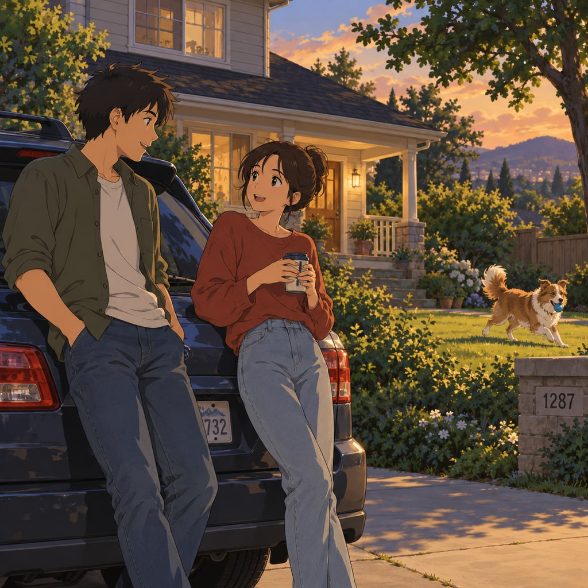
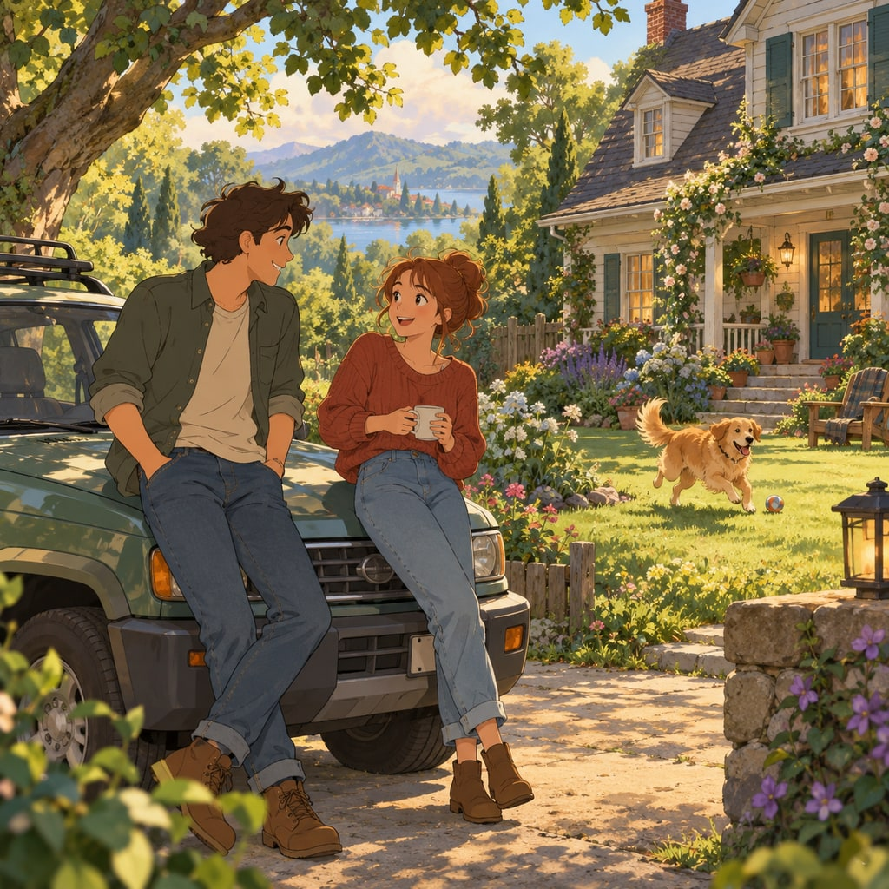
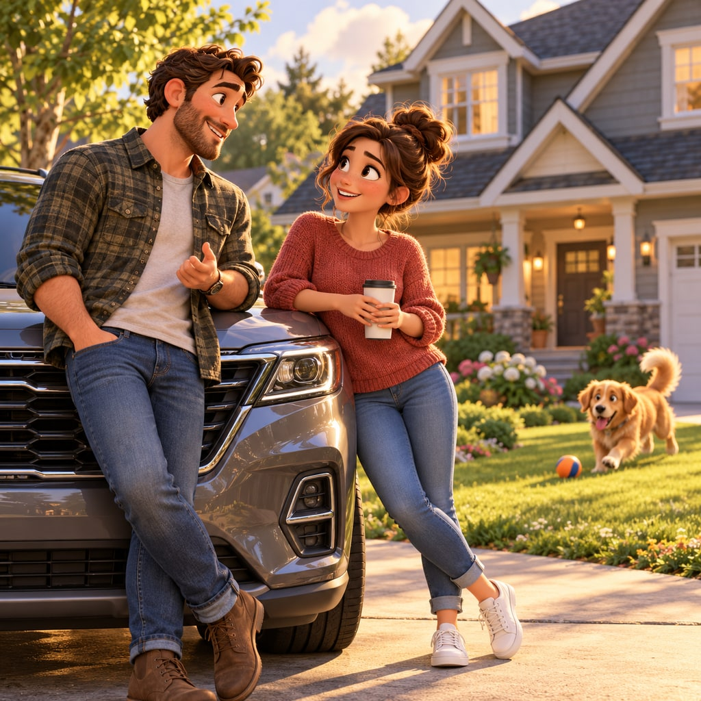
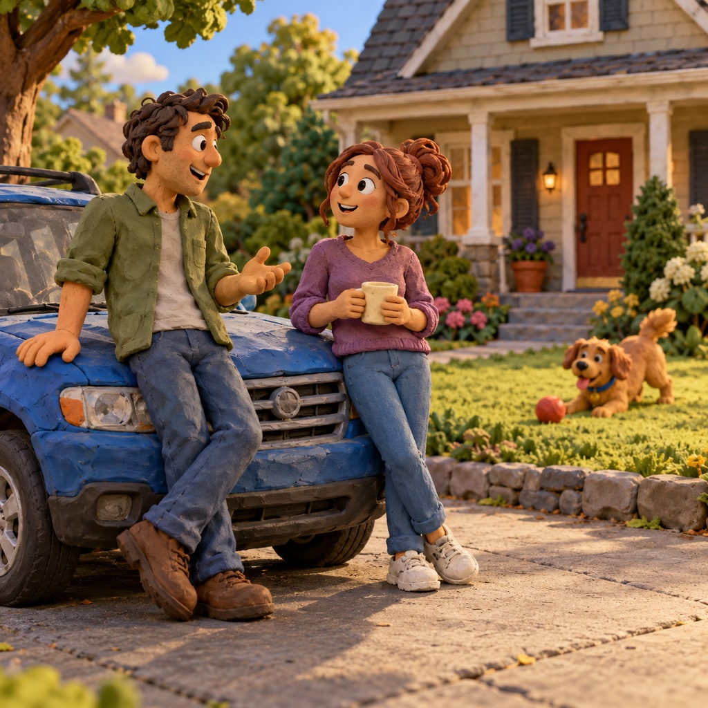
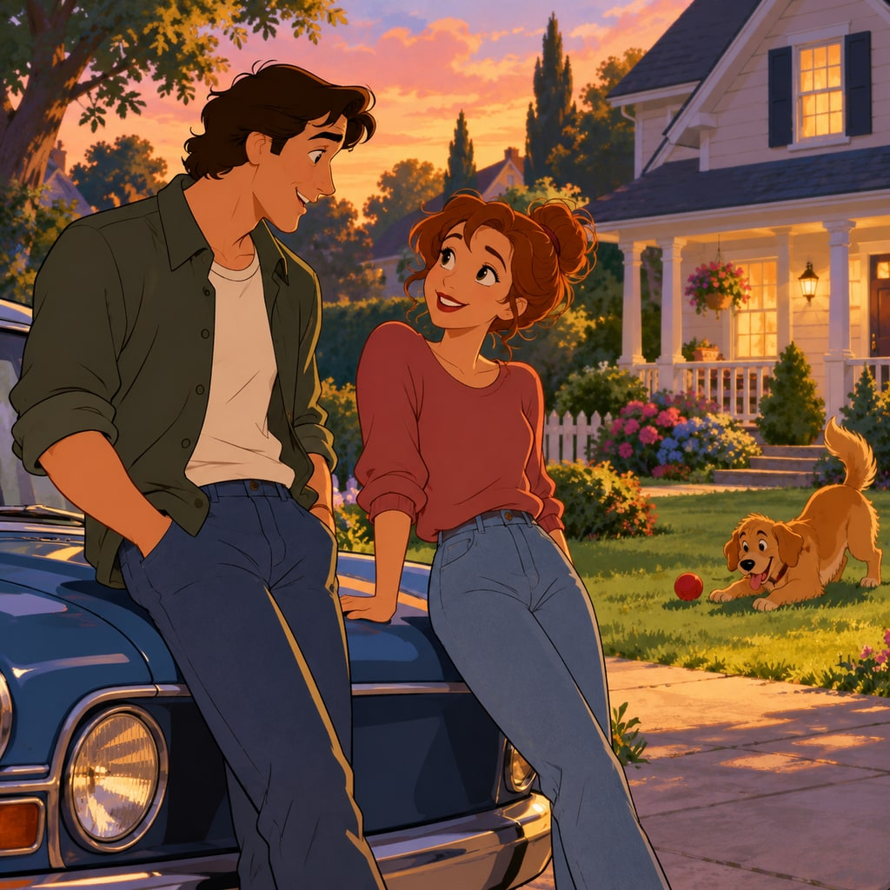
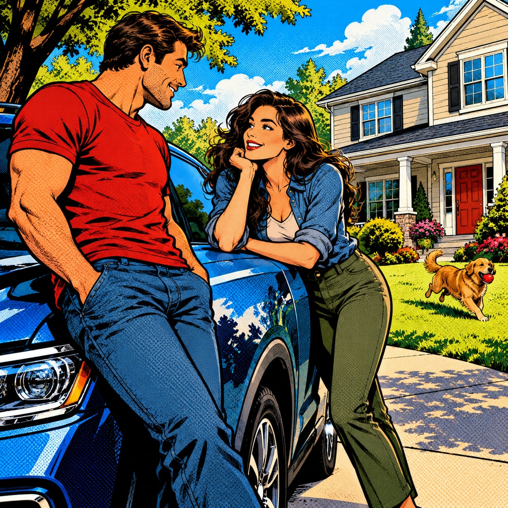
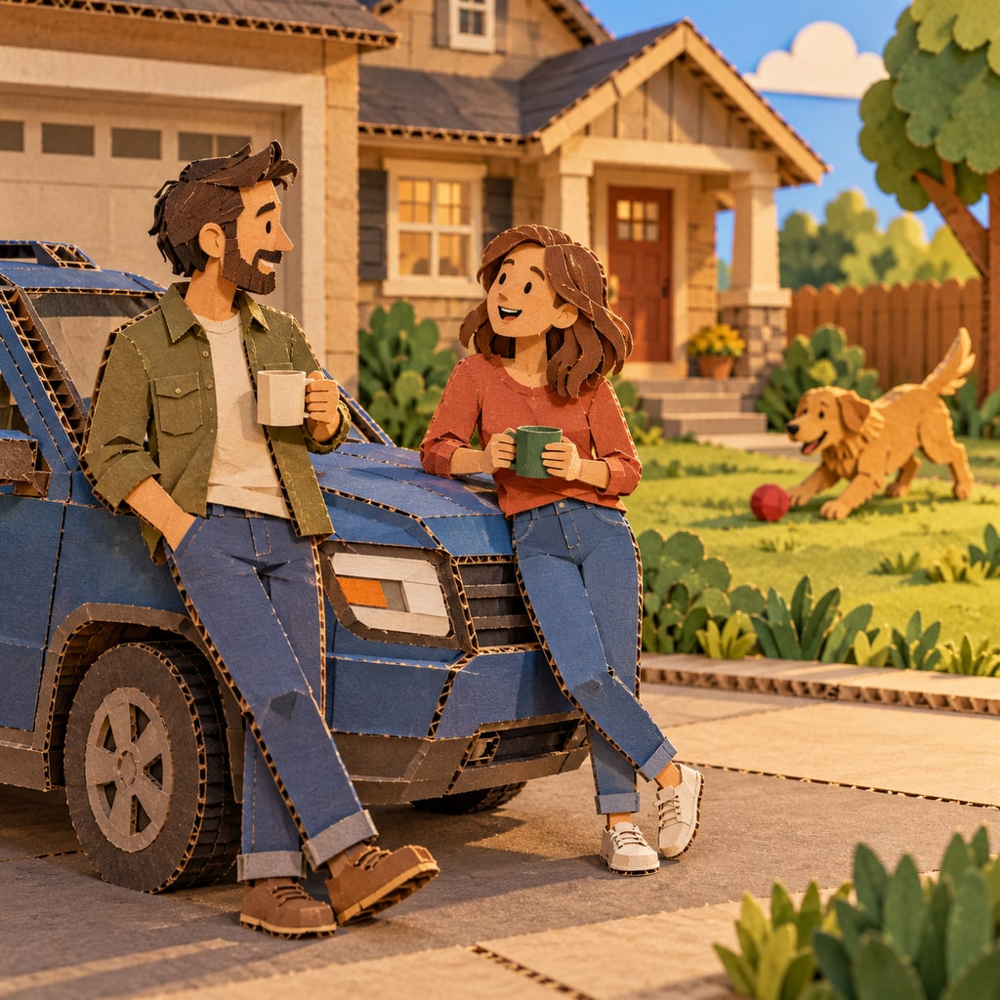
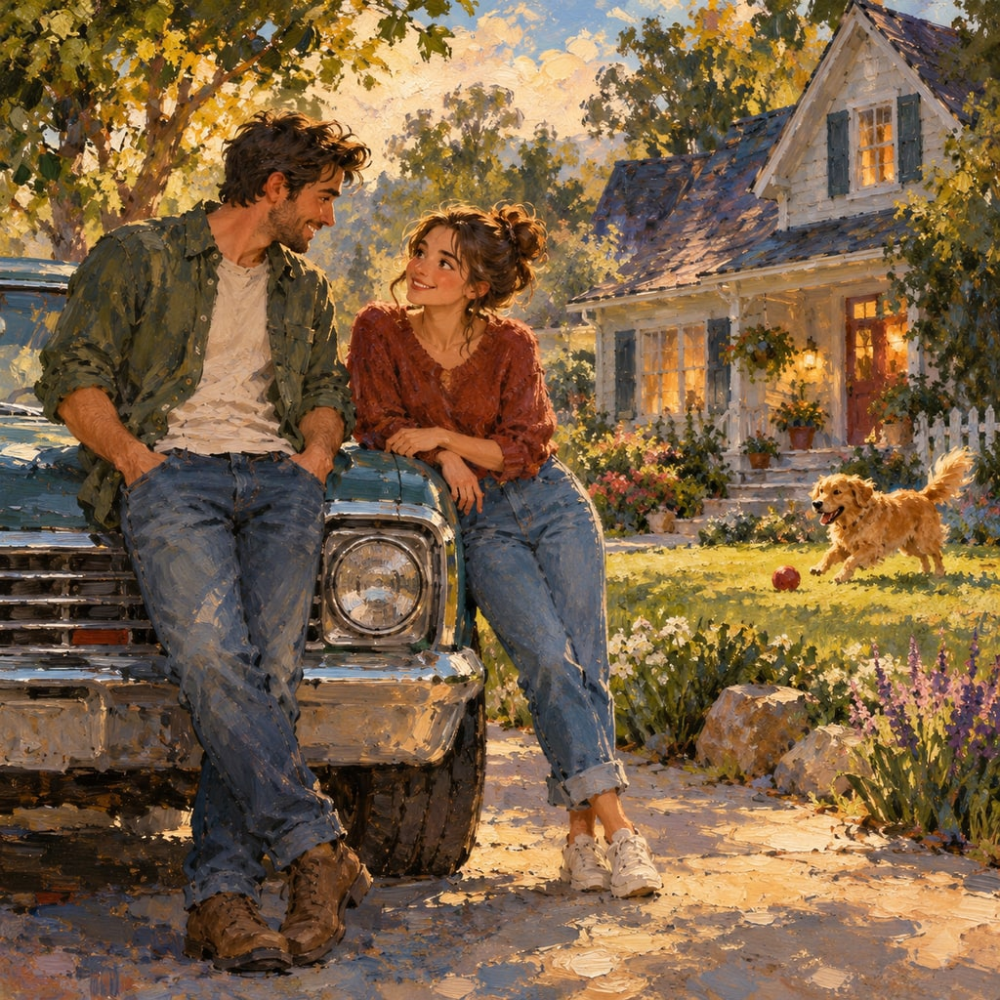
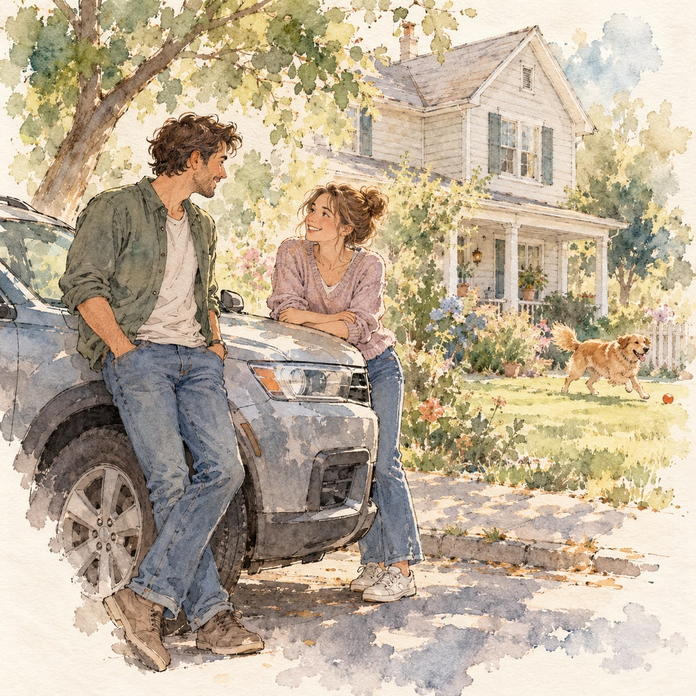
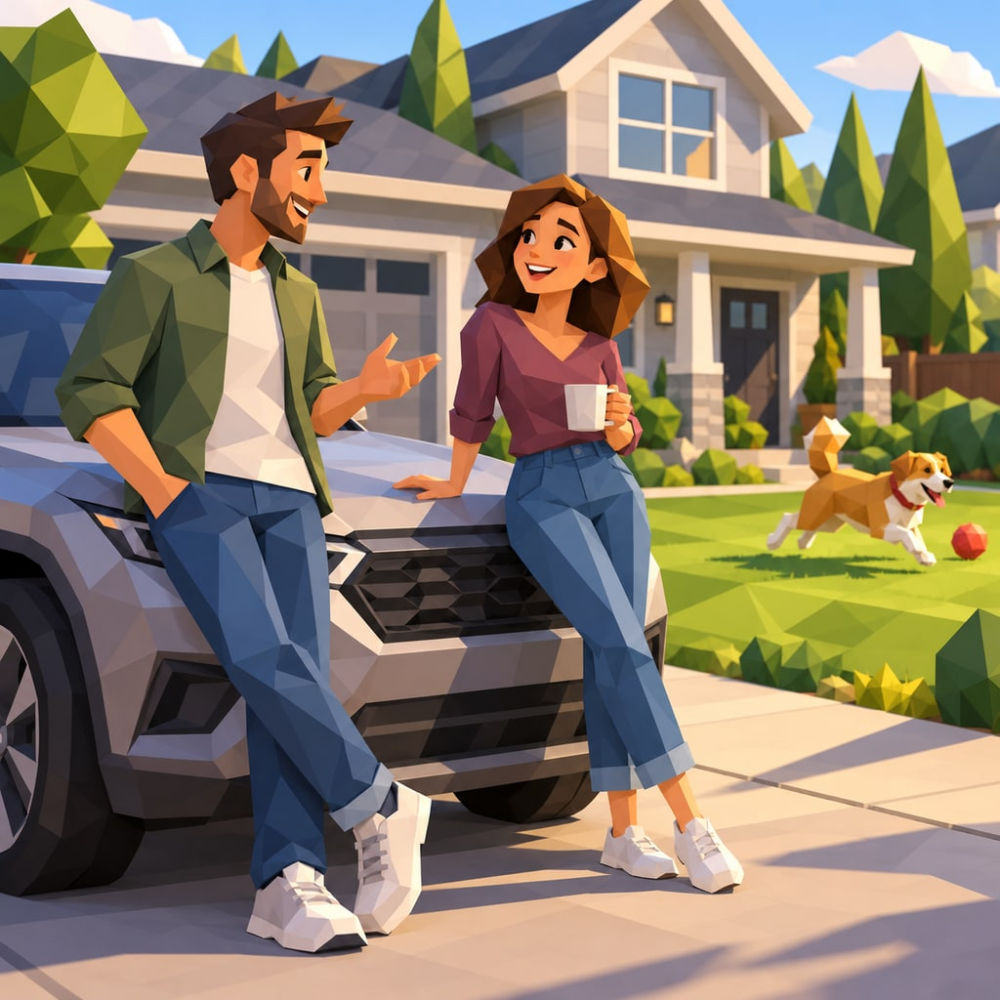

**Base prompt**

```text wrap
Two people talking, leaning on their car, with a suburban house in the background, dog playing in the yard.
```

These recipes change the medium, character design and materials as well as lighting and color. Studio names are familiar reference points for broad visual families. The prompts describe the look directly so you can adjust it without depending on a studio name.

Append one **style prompt** below to the base prompt to generate the complete scene. Every example uses the same base sentence; clothing, dog breed and other unspecified details are left to the model, so each look can suggest a different interpretation. Use the pictures to compare the whole treatment, not just the color grade.

To request the same layout, begin with `Create one square 1024x1024 image.`, then add the base and style prompts. These examples used the built-in image generator with default settings and were exported as 1024×1024 JPEGs. Results vary between runs.

Browse the other categories: [Modern Cinema](../modern-cinema/), [Classic Cinema](../classic-cinema/), [Cell Phone](../cell-phone/), [Animated](../animated/) and [Experimental Cinema](../experimental-cinema/).

## Anime



**Style prompt**

```text wrap
Render this as a Japanese anime film still. Use clean expressive linework, cel-shaded characters, carefully painted backgrounds, distinct light and shadow shapes and a restrained cinematic color palette. Give faces readable, stylized expressions and use purposeful composition. Keep the image a finished animation frame rather than a sketch or a live-action photograph.
```

Graphic character drama and cel-shaded adventure.

## Hand-painted Fantasy (Ghibli)



**Style prompt**

```text wrap
Render this as a gentle hand-drawn fantasy animation still with lush hand-painted backgrounds. Use softly outlined expressive characters, nuanced watercolor-like greens, warm natural light and abundant lovingly observed environmental detail. Let the everyday setting feel quietly magical, comfortable and alive. Keep a flat drawn animation aesthetic with subtle painterly depth.
```

Quiet wonder and richly observed everyday life.

## Family 3D (Pixar)



**Style prompt**

```text wrap
Render this as a polished family-feature 3D animation still. Use appealing stylized character proportions, expressive faces, rounded shapes, detailed tactile materials and warm cinematic lighting. Add soft global illumination and convincing contact shadows while keeping the design clearly animated. The atmosphere should feel friendly, emotionally readable and full of life.
```

Expressive family stories and approachable comedy.

## Claymation



**Style prompt**

```text wrap
Render this as a handmade claymation film still. Build the people, car, house and dog from colored modeling clay, with visible thumbprints, uneven edges and slightly imperfect sculpted forms. Use miniature-set lighting, tangible contact shadows and a warm playful palette. Keep the scene recognizably physical and handcrafted rather than glossy computer animation.
```

Tactile comedy and charming handmade worlds.

## Classic Cel Animation (Disney Classic)



**Style prompt**

```text wrap
Render this as a classic hand-drawn cel-animation feature still. Use graceful character silhouettes, expressive faces, flowing ink contours, flat painted color fills and softly painted background scenery. Apply warm theatrical lighting through clearly designed color and shadow shapes. The mood is enchanting and storybook-like, with a polished traditional 2D finish.
```

Storybook romance, musical fantasy and expressive traditional drawing.

## Superhero Comic



**Style prompt**

```text wrap
Render this as a bold superhero-comic animation still. Use strong black ink contours, graphic shadow shapes, energetic perspective, saturated primary colors, halftone texture and clear dramatic silhouettes. Let the ordinary interaction feel visually charged without changing its basic action. Make one coherent illustrated frame, with no panels, captions, lettering or speech bubbles.
```

Graphic action and larger-than-life energy.

## Cardboard Cutout



**Style prompt**

```text wrap
Render this as a handmade cardboard cutout animation still. Construct every visible subject from layered colored card, with exposed corrugated edges, simple flat shapes, visible folds and small shadows between layers. Use warm miniature-stage lighting and a playful limited palette. Keep the material unmistakably paper and cardboard rather than smooth plastic or clay.
```

Playful handmade stories and deliberately simple design.

## Painterly



**Style prompt**

```text wrap
Render this as a painterly animated film still made from textured oil and gouache brushwork. Use expressive visible strokes, broken color, soft-edged atmospheric backgrounds and more defined faces at the visual focus. Shape the light with painted color rather than photographic sharpness. Keep a cohesive, richly textured image with an emotional, handcrafted atmosphere.
```

Art films and emotion expressed through brushwork.

## Ink and Watercolor



**Style prompt**

```text wrap
Render this as an ink-and-watercolor animation still. Use delicate irregular pen outlines, transparent washes, soft pigment blooms, visible paper texture and a light restrained palette. Let some background edges dissolve into the paper while keeping the people and main objects readable. Create a quiet, airy and lyrical drawn scene rather than photorealism.
```

Gentle memories and airy illustrated storytelling.

## Low-poly



**Style prompt**

```text wrap
Render this as a stylized low-poly 3D animation still. Build characters and surroundings from clearly visible geometric facets, simplified silhouettes and flat-shaded surfaces. Use a small harmonious palette, clean directional lighting and crisp polygonal shadows. Keep faces expressive through simple shapes and make the scene playful, readable and intentionally geometric.
```

Graphic game-like worlds and economical geometric design.

## References

The recipes are broad visual interpretations rather than reproductions of particular characters or film frames. Pixar’s [RenderMan lighting tutorial](https://renderman.pixar.com/only-a-dream) shows how lighting choices help tell a story in a 3D scene; the same principle informs the family 3D recipe here.
