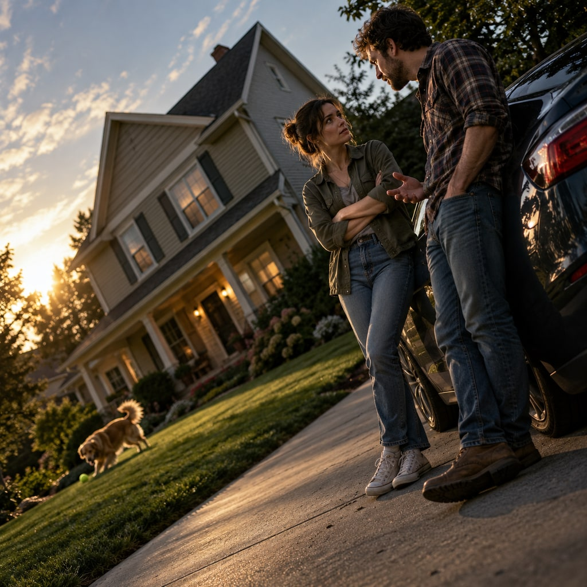
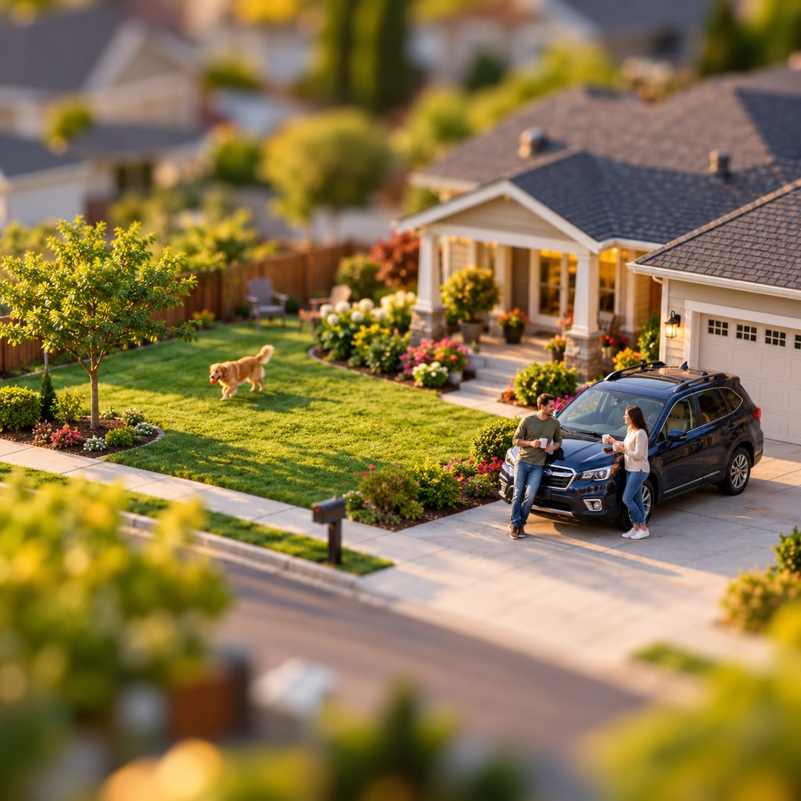
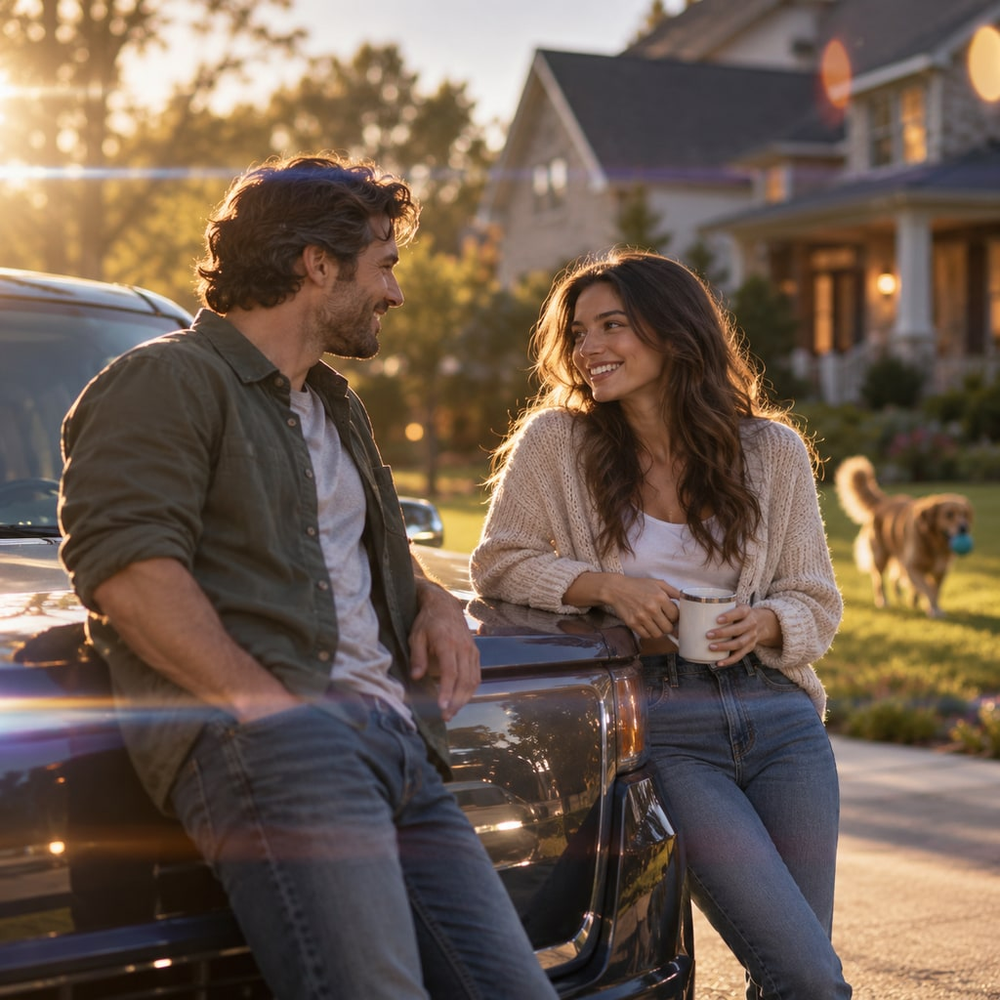
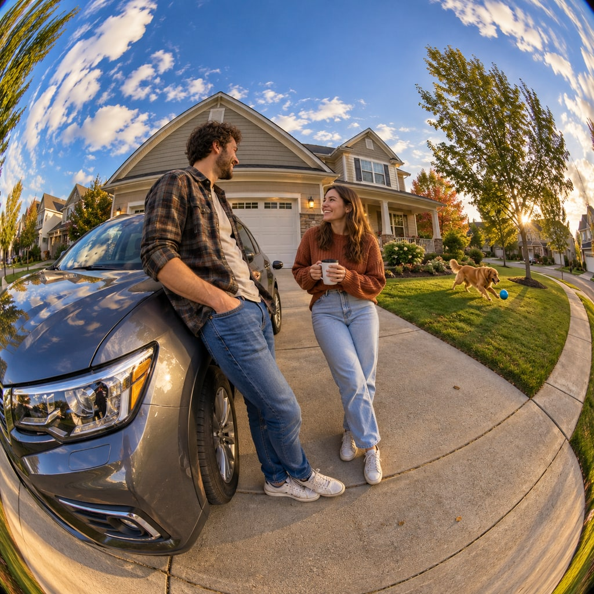
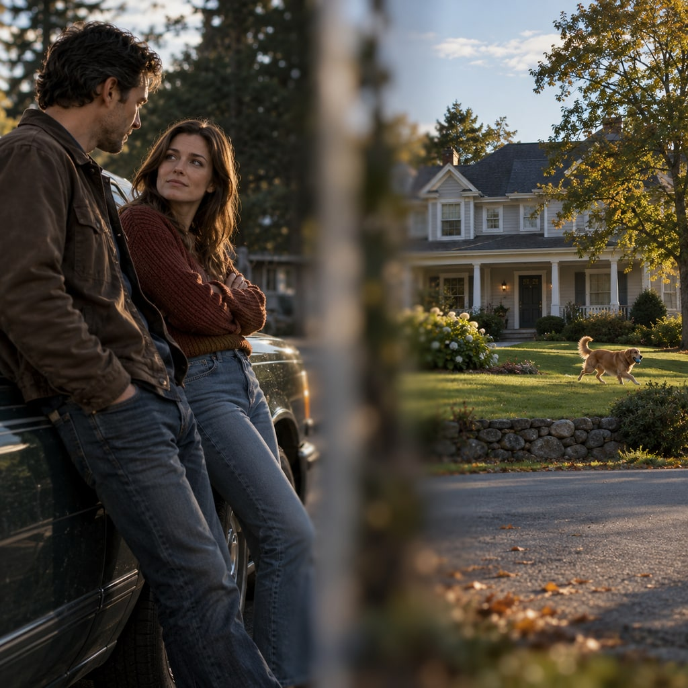
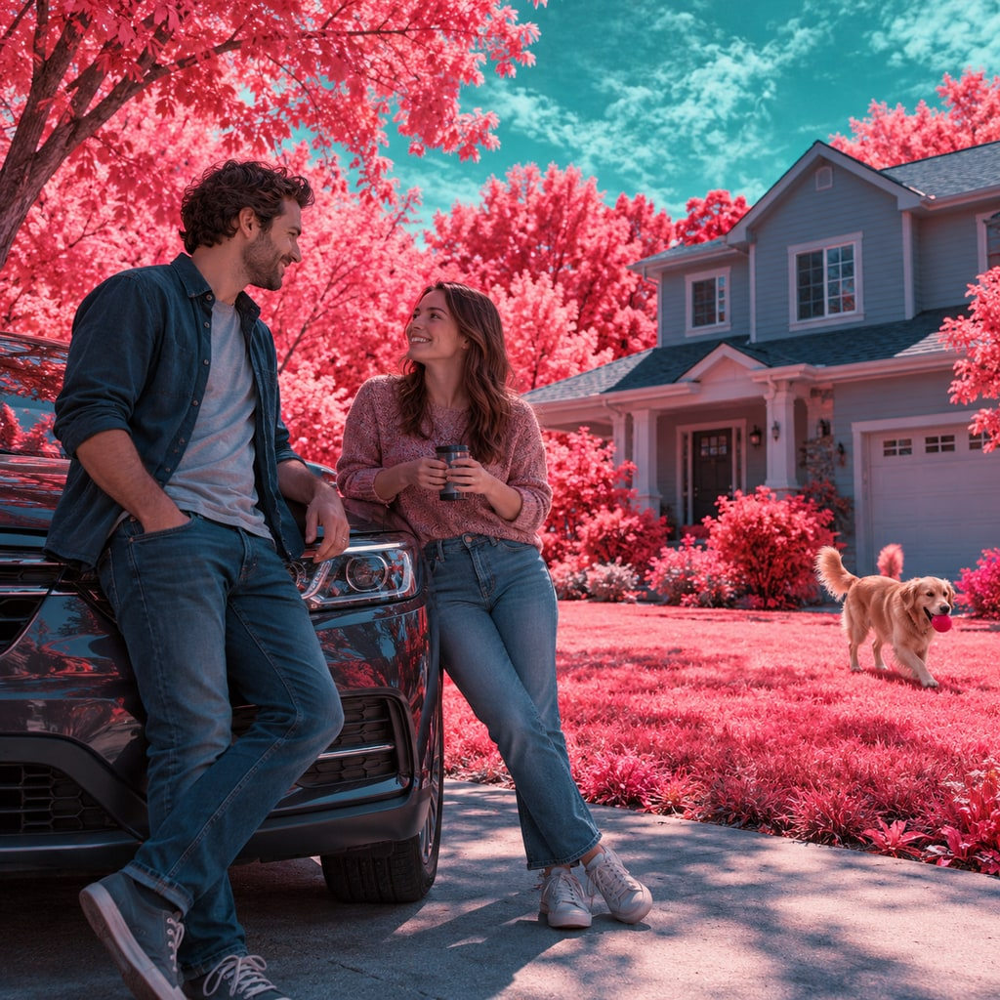
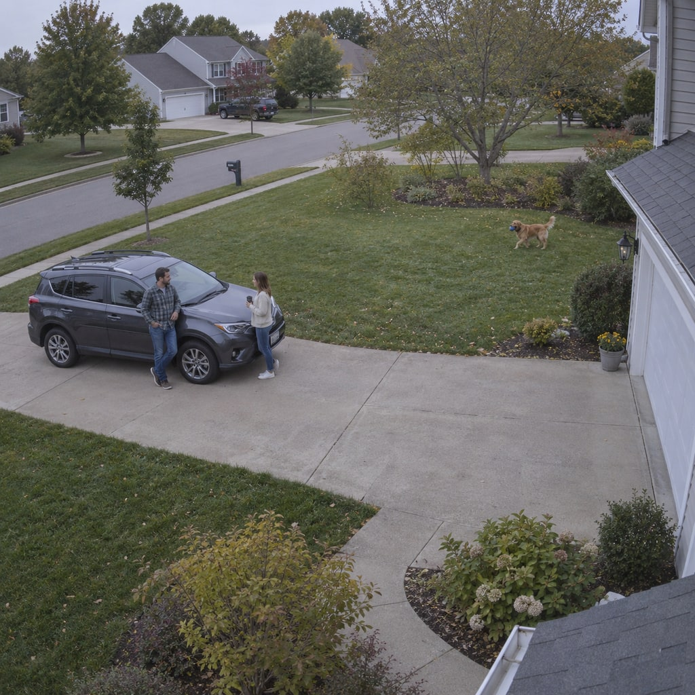
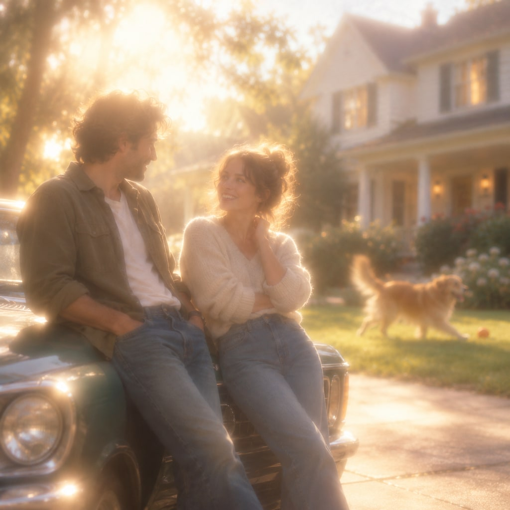

**Base prompt**

```text wrap
Two people talking, leaning on their car, with a suburban house in the background, dog playing in the yard.
```

These treatments concentrate on framing, optics and perception. They can be combined with a modern or classic cinema palette after you choose a look. A still image suggests one frame of a film; it cannot demonstrate camera movement or temporal effects.

Append one **style prompt** below to the base prompt to generate the complete scene. Every example uses the same base sentence; clothing, dog breed and other unspecified details are left to the model, so each look can suggest a different interpretation. Use the pictures to compare the whole treatment, not just the color grade.

To request the same layout, begin with `Create one square 1024x1024 image.`, then add the base and style prompts. These examples used the built-in image generator with default settings and were exported as 1024×1024 JPEGs. Results vary between runs.

Browse the other categories: [Modern Cinema](../modern-cinema/), [Classic Cinema](../classic-cinema/), [Cell Phone](../cell-phone/), [Animated](../animated/) and [Experimental Cinema](../experimental-cinema/).

## Dutch Angle (Tilted Frame)



**Style prompt**

```text wrap
Photograph this as a cinema still with a pronounced Dutch angle. Rotate the camera so the horizon and the house appear diagonally tilted, while the people and surroundings remain physically upright within the scene. Use a dynamic off-balance composition, clear photographic detail and tense directional light. Make the viewpoint unsettling without turning the image into an abstract collage.
```

Unease and disorientation. This is a tilted camera, rather than miniature-style focus.

## Tilt-shift Miniature



**Style prompt**

```text wrap
Photograph this as a tilt-shift miniature-style cinema still from an elevated oblique viewpoint. Use a narrow strip of sharp focus across the central action, with strong gradual blur toward the near and far areas. Add crisp colors and precise tiny-looking detail within the focus band. Let the real suburban scene appear like a photographed model village.
```

A toy-world impression created by viewpoint and selective focus.

## Anamorphic Lens



**Style prompt**

```text wrap
Photograph this as a digital cinema still with an anamorphic lens character, composed within a square frame. Use subtle horizontal light streaks, oval out-of-focus highlights, gentle edge softness and strong separation between the people and background. Keep realistic faces and a luminous cinematic atmosphere. Suggest the lens treatment without adding letterbox bars.
```

Optical atmosphere and luminous cinema texture; a square sample cannot show widescreen framing.

## Fisheye



**Style prompt**

```text wrap
Photograph this as an experimental cinema still using a rectangular full-frame fisheye lens. Fill the square canvas edge to edge with the scene, keeping every corner exposed. Use an extremely wide field of view, conspicuous barrel distortion and curved straight lines near the edges. Keep the central conversation readable while the surroundings bend around it. Do not include a circular vignette, visible lens rim, black border or film frame.
```

Playful distortion, anxious intimacy and exaggerated space.

## Split Diopter



**Style prompt**

```text wrap
Photograph this as a cinema still with a pronounced split-diopter lens effect. Compose the nearby people on the left side and the distant house and playing dog on the right. The foreground faces and the far house and dog must all be tack sharp despite their different distances. Place a narrow vertical band of soft focus between the two sharp zones, making the split-field optics visibly unnatural. Avoid ordinary portrait-mode background blur and uniform deep focus; use photographic realism and a precise suspenseful composition.
```

Simultaneous attention to near and far action in a deliberately unnatural focus arrangement.

## False-color Infrared



**Style prompt**

```text wrap
Photograph this as a false-color infrared-inspired experimental film still. Render living foliage in luminous pink and red, shift the sky toward cool cyan, and give other surfaces unusual but consistent color relationships. Preserve the recognizable photographic scene and readable human faces. Create a dreamlike spectral world through color response rather than added fantasy objects.
```

Dreams, altered perception and an unfamiliar natural world.

## Fixed Surveillance



**Style prompt**

```text wrap
Render this as a frame from a fixed high-mounted surveillance camera. Use a wide detached viewpoint, deep focus, flat automatic exposure, subdued color, slight digital noise and modest compression artifacts. Make the conversation a small event within the surrounding space. Keep the image plain and observational, without a timestamp, camera label, interface or dramatic cinema lighting.
```

Detached observation and tension from a distant viewpoint.

## Dreamy Diffusion



**Style prompt**

```text wrap
Photograph this as a dreamlike experimental cinema still through strong optical diffusion. Use luminous bloom around bright areas, soft contrast, hazy edges, pale warm colors and gently glowing backlight. Keep faces and the base scene recognizable while making fine detail feel softened by atmosphere. Create a floating, remembered quality rather than simple missed focus.
```

Dreams, memory and subjective romance.

## References

In the [BFI interview with Eran Creevy](https://www.bfi.org.uk/interviews/welcome-punch-eran-creevy-interview), he describes using tilted camera angles to create unease. [ARRI’s anamorphic white paper](https://www.arri.com/resource/blob/178026/228c1a0523ed25947174567833cd8fb4/anamorphic-de-squeeze-white-paper-data.pdf) explains the characteristic oval highlights and flare. These prompts suggest visible treatments, not claims that the generator physically used a lens or recorded infrared light.
