**Base prompt**

```text wrap
Two people talking, leaning on their car, with a suburban house in the background, dog playing in the yard.
```

These recipes suggest digital cinema photography. Their differences come from lighting, color, contrast and production design, as well as camera treatment. Choose a mood first, then adapt the scene for your film.

Append one **style prompt** below to the base prompt to generate the complete scene. Every example uses the same base sentence; clothing, dog breed and other unspecified details are left to the model, so each look can suggest a different interpretation. Use the pictures to compare the whole treatment, not just the color grade.

To request the same layout, begin with `Create one square 1024x1024 image.`, then add the base and style prompts. These examples used the built-in image generator with default settings and were exported as 1024×1024 JPEGs. Results vary between runs.

Browse the other categories: [Modern Cinema](../modern-cinema/), [Classic Cinema](../classic-cinema/), [Cell Phone](../cell-phone/), [Animated](../animated/) and [Experimental Cinema](../experimental-cinema/).

## Naturalistic

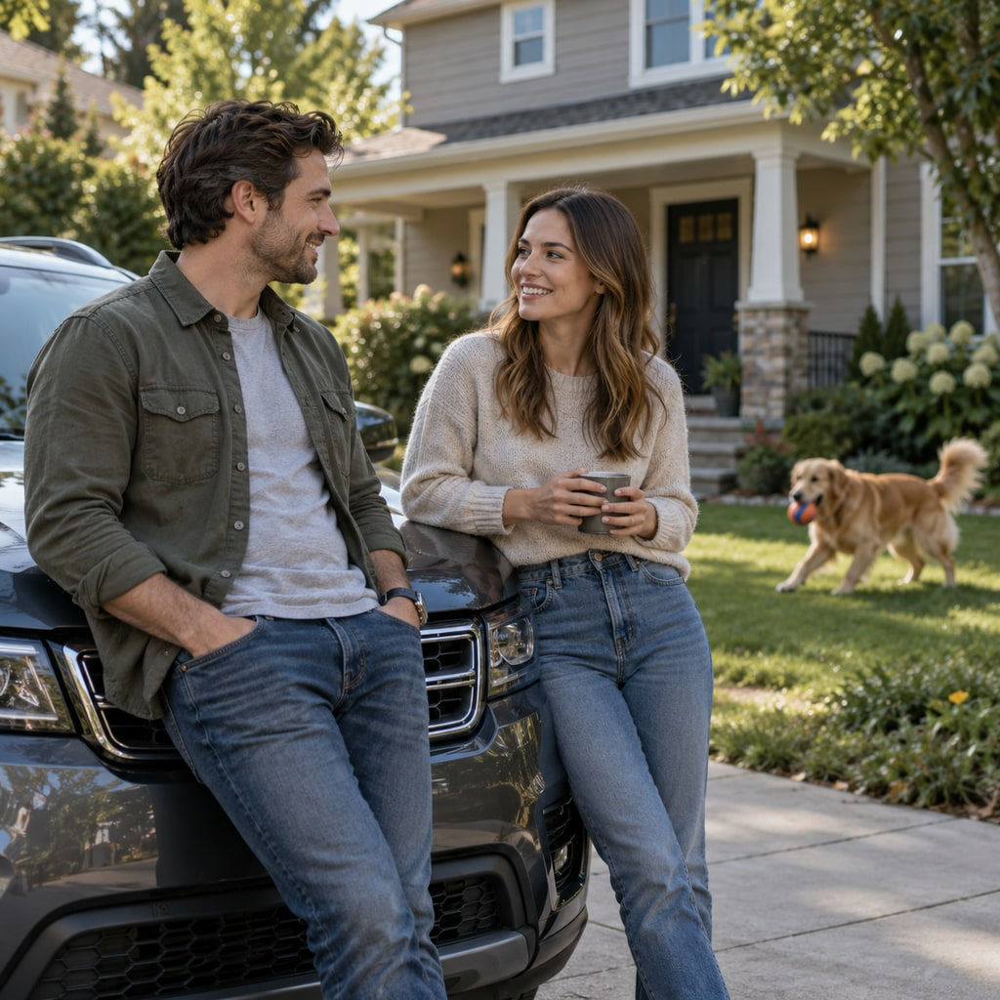

**Style prompt**

```text wrap
Photograph this as a naturalistic digital cinema still. Use believable available daylight, neutral white balance, lifelike skin tones, restrained saturation, gentle highlight roll-off and moderate depth of field. Preserve real surface texture and readable shadows. The mood is ordinary, grounded and observational.
```

Everyday drama and realistic dialogue.

## Gritty Desaturated

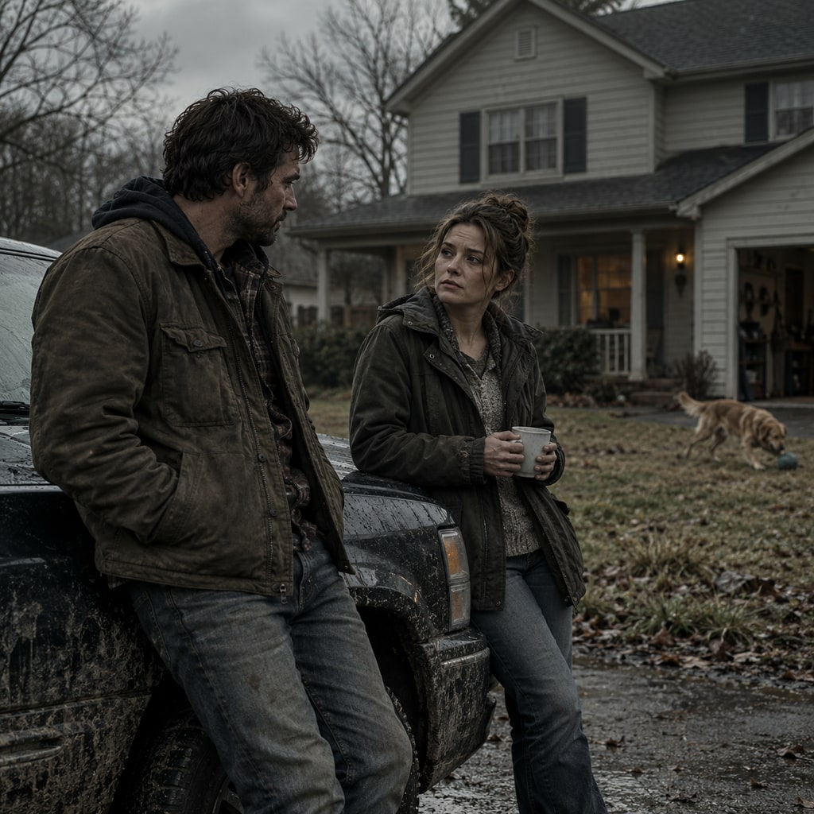

**Style prompt**

```text wrap
Photograph this as a severe, gritty digital cinema still. Use cold overcast light, an olive-gray palette, drained colors, rough surface texture and oppressive shadows. Keep faces believable and visible, with restrained contrast in the midtones and an uneasy, unsentimental atmosphere. Avoid a polished commercial finish.
```

Harsh drama, disaster stories and psychological tension. Think of the oppressive realism associated with Chernobyl.

## Candy-colored Plastic

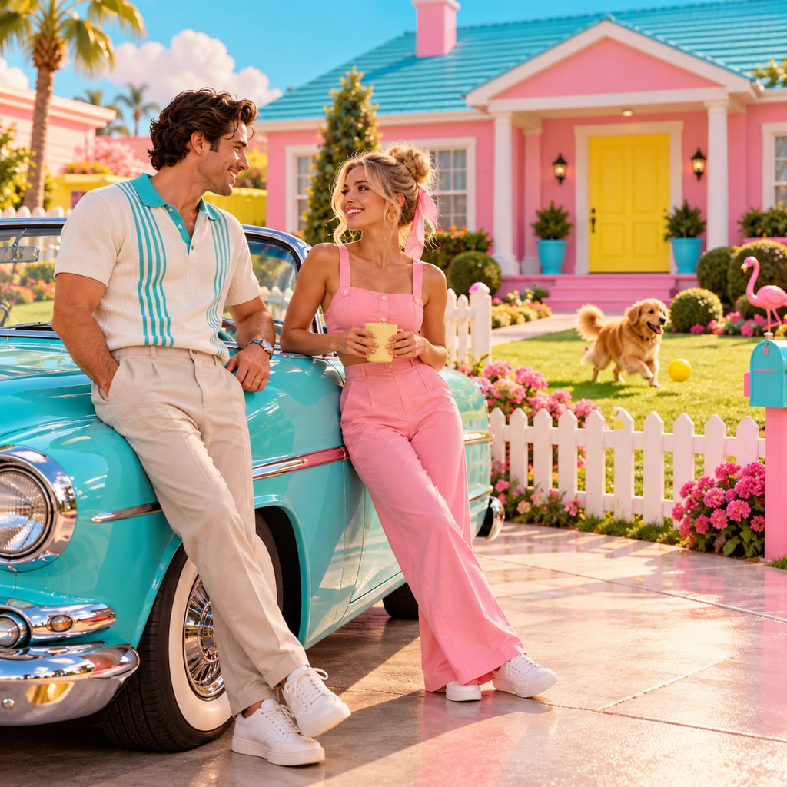

**Style prompt**

```text wrap
Photograph this as a live-action digital cinema still in an exuberant artificial world. Use candy pink, turquoise and sunny yellow, bright soft studio-like illumination, immaculate glossy surfaces and deliberately coordinated colors. Keep the people photographic while the environment feels playfully manufactured. Create a cheerful, theatrical, toy-world atmosphere.
```

Happy fantasy, satire and musical comedy; a starting point for a Barbie-like artificial world.

## Epic Fantasy

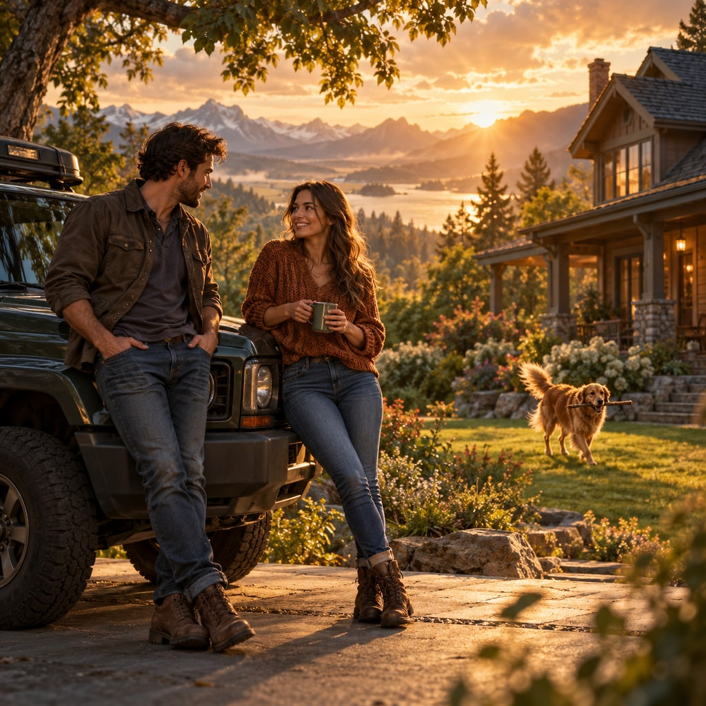

**Style prompt**

```text wrap
Photograph this as an epic fantasy cinema still captured digitally. Give the scene luminous golden backlight, cool shaded greens, rich earth colors, subtle atmospheric haze and sculpted highlights. Use a sense of depth and an expansive, painterly composition while retaining photographic faces and materials. The mood is mythic, inviting and quietly adventurous.
```

Adventure and wonder; a starting point for the warm, expansive feeling of a fantasy epic such as The Lord of the Rings.

## Low-key Horror

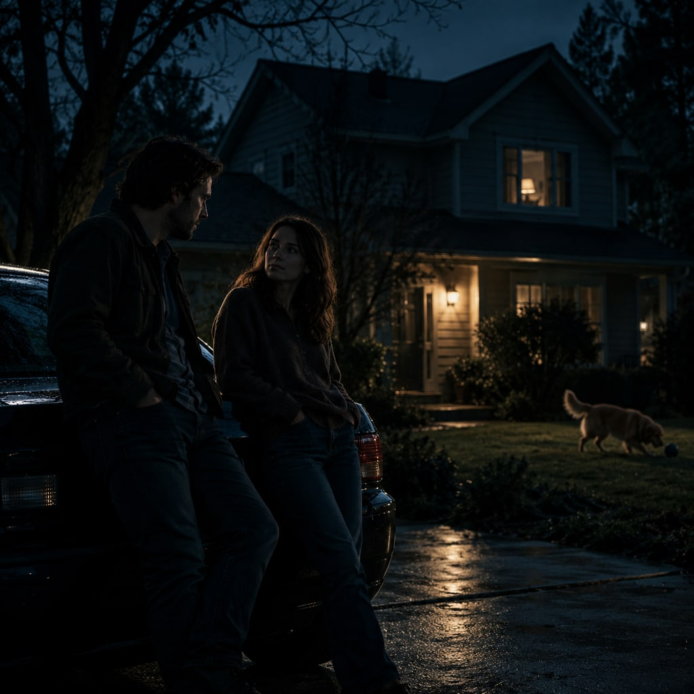

**Style prompt**

```text wrap
Photograph this as a low-key digital horror cinema still at blue hour. Use sparse motivated light, cool blue-green shadows, very restrained saturation and large areas of darkness. Let small highlights reveal faces and important shapes without illuminating everything. The everyday setting should feel ominous, quiet and full of unseen space.
```

Horror and suspense through darkness and uncertainty.

## Cyberpunk Neon

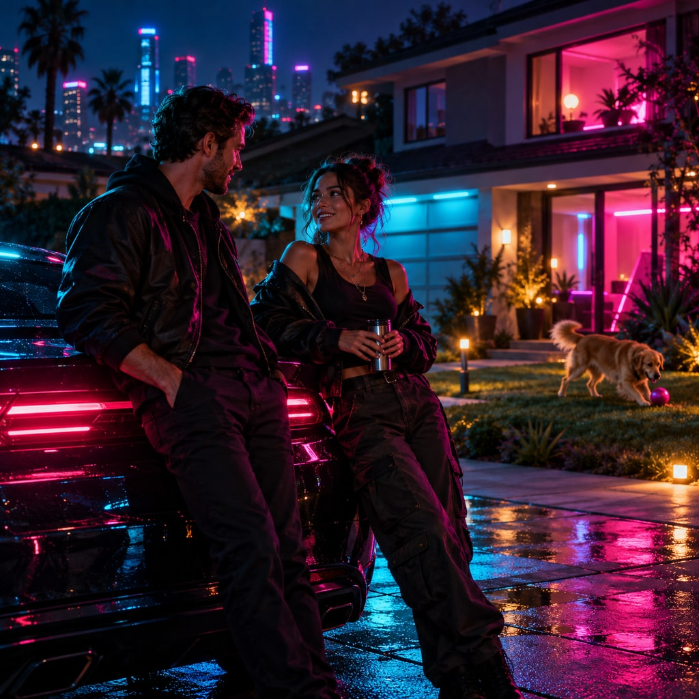

**Style prompt**

```text wrap
Photograph this as a digital cyberpunk cinema still at night. Use saturated cyan and magenta practical lighting, dark backgrounds, colored reflections on glossy surfaces and luminous highlights with a slight bloom. Balance cool shadows against warm skin. Create a dense, electric atmosphere while keeping the conversation readable.
```

Science fiction, nocturnal thrillers and heightened city moods.

## Indie Natural Light

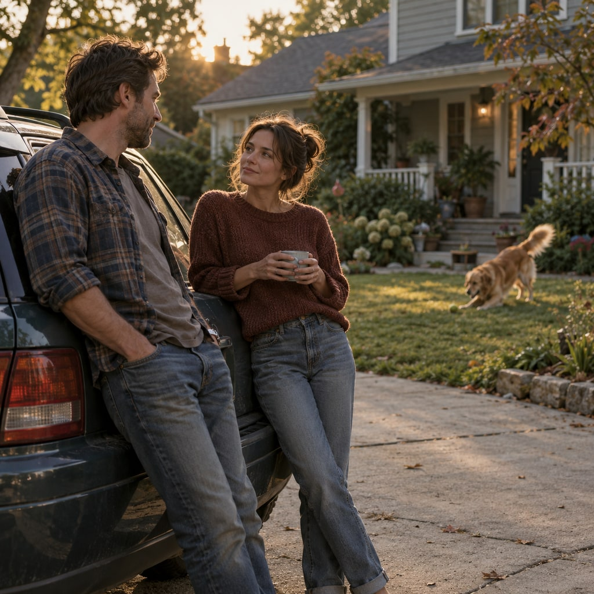

**Style prompt**

```text wrap
Photograph this as an intimate independent digital cinema still. Use soft late-afternoon available light, gently lifted blacks, a restrained warm palette, imperfect candid framing and modest contrast. Keep skin and surfaces unretouched, with a quiet observational distance and no glossy advertising finish. The mood is personal, fragile and unhurried.
```

Small personal stories and reflective art films.

## Muted Monochrome

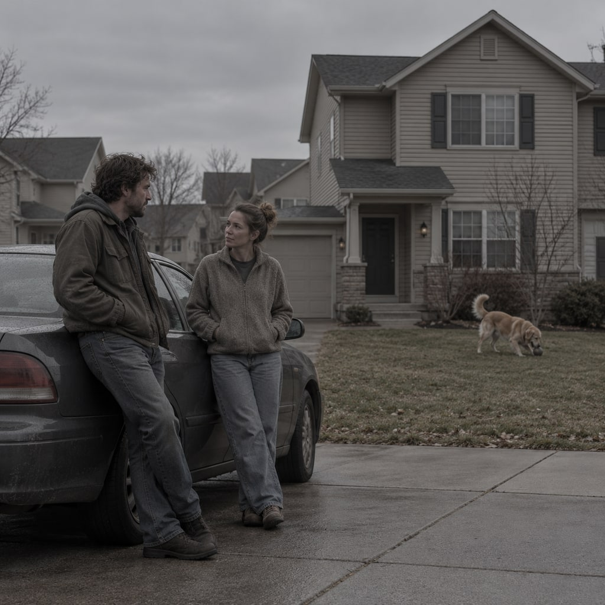

**Style prompt**

```text wrap
Photograph this as an austere digital cinema still with an almost monochromatic color palette. Use flat overcast daylight, closely spaced gray and taupe tones, very low saturation and restrained contrast. Retain faint traces of natural color rather than pure black and white. Make the ordinary surroundings feel repetitive, emotionally distant and subdued.
```

Drab routines, alienation and restrained social drama.

## Clinical Cool

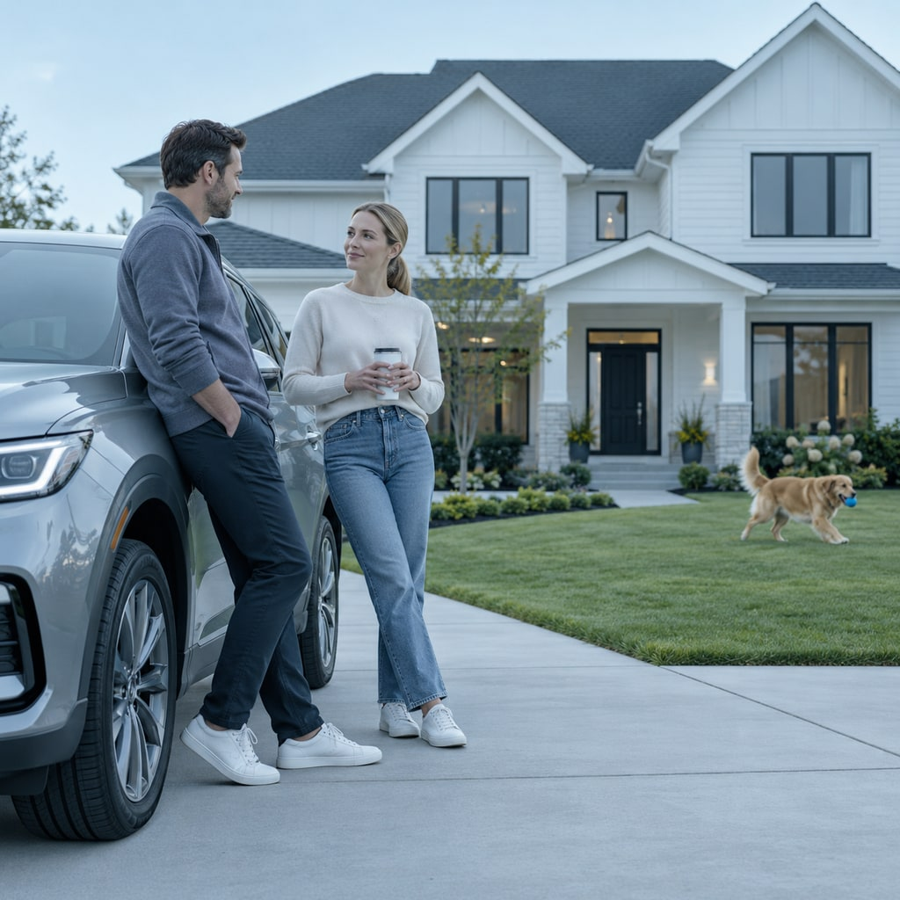

**Style prompt**

```text wrap
Photograph this as a clinical digital cinema still. Use cool white illumination, pale cyan highlights, clean whites, low color warmth and precise, orderly framing. Surfaces should look exceptionally clean and crisply defined, with little visual clutter and controlled shadows. Keep human skin plausible but let the overall atmosphere feel sterile, detached and institutional.
```

Medical drama, controlled environments and unsettling perfection.

## Nature Documentary

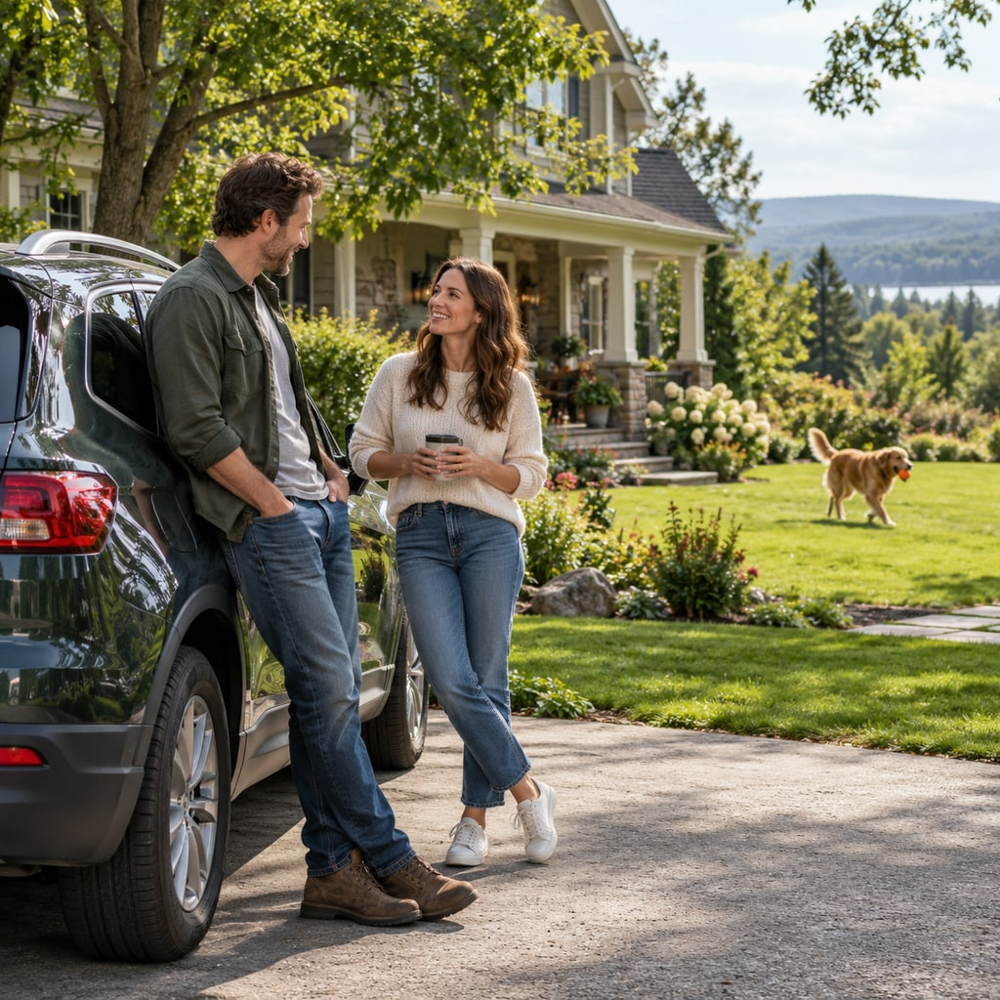

**Style prompt**

```text wrap
Photograph this as a premium nature documentary still captured with a digital cinema camera. Use fresh natural daylight, accurate greens, fine detail in foliage and fur, clear atmospheric depth and balanced exposure. Give the living environment visual importance alongside the people. Favor patient observational framing and honest natural colors over a dramatic grade.
```

Nature stories, outdoor observation and calm factual films.

## Vibrant Cultural

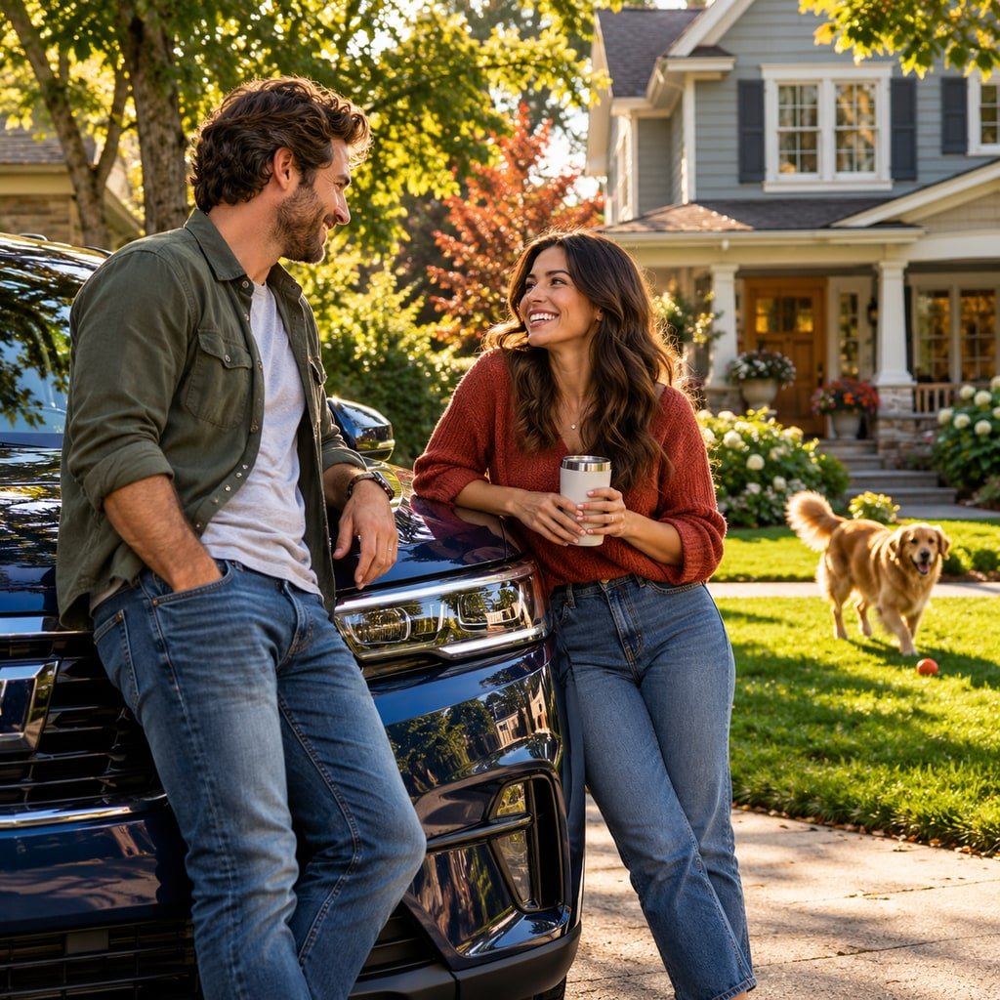

**Style prompt**

```text wrap
Photograph this as a vibrant contemporary digital cinema still. Use rich jewel colors, warm expressive sunlight, lively color separation and textured, tangible surroundings. Keep skin tones natural and let the palette feel celebratory and full of everyday life. Favor confident saturation and energetic visual rhythm without bleaching highlights or smoothing away detail.
```

Celebration, community stories and films with a vivid sense of place. The palette supplies energy; the story supplies the culture.

## Sunlit Feel-good

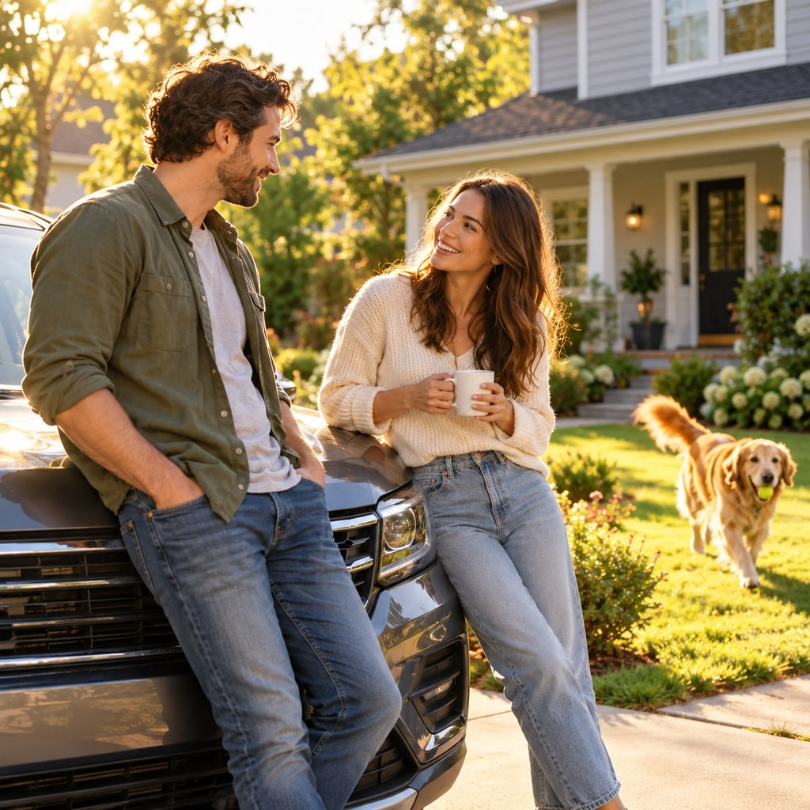

**Style prompt**

```text wrap
Photograph this as a warm feel-good digital cinema still. Use bright golden daylight, soft open shadows, gentle backlight, warm skin tones and fresh, moderately saturated colors. Let highlights glow without losing texture, and keep the framing relaxed and welcoming. Create an optimistic, easygoing atmosphere with photographic people and believable surroundings.
```

Friendly comedy, romance and reassuring endings.

## References

The recipes above are our interpretations, not official film presets. For the filmmakers’ approaches, see the [Jakob Ihre interview about Chernobyl](https://britishcinematographer.co.uk/jakob-ihre-fsf-chernobyl/) and the [ASC conversation with Rodrigo Prieto about Barbie](https://theasc.com/video/clubhouse-conversations-barbie/).
